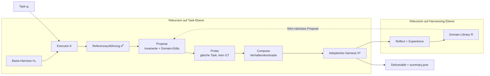
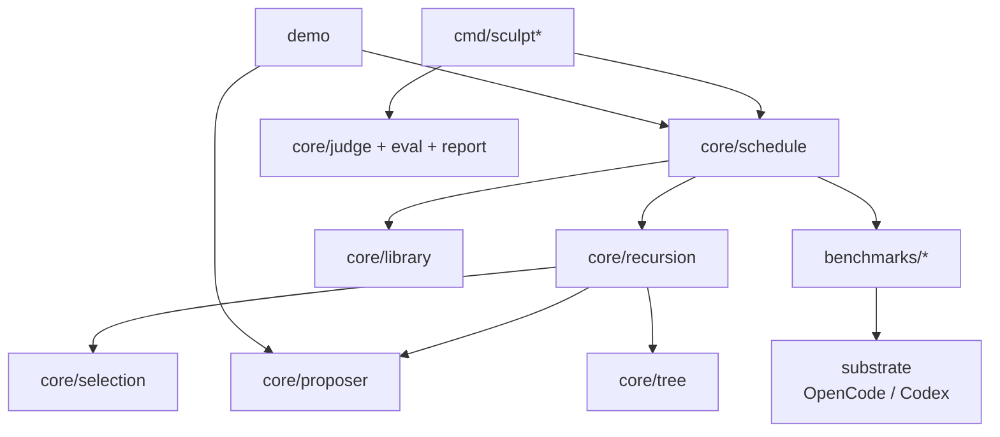

<p align="center">
  
</p>

<h1 align="center">Sculpt</h1>

<p align="center">
  <b>Rekursives Agenten-Harnessing in Go</b><br/>
  Verfeinere das System <i>um</i> ein Modell mit festen Gewichten — und merke, was funktioniert hat.
</p>

<p align="center">
  <a href="README.md">English</a> ·
  <a href="README.zh-CN.md">简体中文</a> ·
  <a href="README.ja.md">日本語</a> ·
  <a href="README.ko.md">한국어</a> ·
  <a href="README.es.md">Español</a> ·
  <a href="README.fr.md">Français</a> ·
  <a href="README.de.md">Deutsch</a> ·
  <a href="README.pt-BR.md">Português</a> ·
  <a href="docs/i18n/README.md">More</a>
</p>

<p align="center">
  <a href="LICENSE"></a>
  <a href="https://go.dev/"></a>
  <a href="https://arxiv.org/abs/2610.14224"></a>
  <a href="docs/EVAL.md"></a>
  <a href="#selbst-evolution"></a>
</p>

<p align="center">
  <code>go test ./demo -run TestSelfEvolution</code>
  &nbsp;·&nbsp;
  <code>go run ./cmd/sculpt-demo --k 2</code>
  &nbsp;·&nbsp;
  <b>Offline-Schleife braucht keine API-Keys</b>
</p>

---

Ein **Harness** ist alles um ein Modell herum, damit es als Agent handelt —
Prompts, Tools, Memory, Skills, Scripts, Orchestrierung.

**Harnessing** optimiert diese Hülle **ohne Modellgewichte anzufassen**.

**Sculpt** ist ein Go-Framework für **rekursives Agenten-Harnessing** in einer offenen Welt:
Agenten treffen Aufgaben, die beim Harness-Design nie gesehen wurden. Gewichte bleiben
fix; zwei verschachtelte Schleifen verbessern das Harness — dieselbe Methode wie
[Harness²](https://github.com/google-research/harness2)
([Paper](https://arxiv.org/abs/2610.14224)).

| | |
|---|---|
| **Task-Ebene** | Kontrastives **Propose → Probe → Compose**: editieren, auf derselben Aufgabe probe, aus Verhaltenskontrasten compose — **kein Ground-Truth-Feedback** im Improver. |
| **Harnessing-Ebene** | Speichert adoptiertes Harness + evidenzgestützte Lessons in einer domainweisen **library**, die die nächste Aufgabe führt. |

> Offline-Vertrag (verifiziert): **base 0% → refined 100% (+100 pt)** über 100/100 deterministische Runden.
> Live-DeepSeek-Repair-Smoke: **100/100** unter demselben Δ-Vertrag.

## Warum Sculpt

- **Gewichte eingefroren** — alle Gewinne kommen vom System um das Modell.
- **Kein Judge-Leak in Improver** — Auswahl ist blind gegenüber Ground Truth.
- **Go-nativ** — typisierte Seams, schnelle Tests, Single-Binary-CLIs.
- **Parallele und sequenzielle** Rekursion (`agg` / `seq`) mit expliziten `R=4k` / `P=3k`.
- **Messbare Selbst-Evolution** — bewertet base vs refined, meldet Δ in Prozentpunkten.
- **Bench-ready Adapter** — JobBench, LAB, WorkBuddy-Bench (+ Offline-Demo).

## Architektur

### Pipeline (Task → Library)



### Package-Map



### Acht editierbare Komponenten

Am Methodenpaper ausgerichtet — die Oberfläche, die Sculpt liest, schreibt und validiert:

| Kontext | Tool-Loop | Orchestrierung |
|---------|-----------|----------------|
| system prompt · guardrails · memory · skills | tool guidance · scripts | subagents · plugins |

## Inhalt

- [Warum Sculpt](#warum-sculpt)
- [Architektur](#architektur)
- [Status](#status)
- [Installation](#installation)
- [Schnellstart](#schnellstart)
- [Selbst-Evolution](#selbst-evolution)
- [Benchmarks](#benchmarks)
- [Experimente](#experimente)
- [Layout](#layout)
- [Internationalisierung](#internationalisierung)
- [Zitation](#zitation)
- [Mitwirken](#mitwirken)
- [Lizenz](#lizenz)
- [Haftungsausschluss](#haftungsausschluss)

## Status

| Bereich | Zustand |
|---------|---------|
| Offline-Demo + Propose–Probe–Compose | ✅ Ready |
| Tree · ledger · recursion · selection · schedule · library · judge | ✅ Ready |
| Resume / selection failure / rejudge-merge | ✅ Tested |
| Selbst-Evolution-Eval (`TestSelfEvolution*`) | ✅ Offline **+100 pt** |
| Live-DeepSeek-Repair-Smoke | ✅ **100/100** |
| CLI: `sculpt` · `sculpt-demo` · `sculpt-judge` · `sculpt-report` · `sculpt-check` | ✅ Ready |
| JobBench- / LAB- / WorkBuddy-Adapter | ✅ Wired |
| Live Execute via OpenCode / Codex | ⏳ Braucht Checkouts + Credentials |

## Installation

```bash
git clone https://github.com/linuslin-cto/Sculpt.git
cd Sculpt
go test ./...
```

**Voraussetzungen**

- Go **1.22+**
- Python **3.x** auf `PATH` (Demo-Executor führt `scripts/summarize.py` aus)
- Optionaler Live-Pfad: OpenCode oder Codex, Datasets, `SCULPT_*` / Provider-Keys

Siehe [docs/SETUP.md](docs/SETUP.md). Niemals Secrets committen — nutze eine gitignorierte `.env`.

## Schnellstart

```bash
# Deterministisches Propose–Probe–Compose (keine Credentials)
go run ./cmd/sculpt-demo --output runs/demo --k 2
go run ./cmd/sculpt-demo --output runs/demo-s7 --k 1 --seed 7

# Task-Stream vorschauen
go run ./cmd/sculpt --bench demo --output runs/demo --k 1 --seed 7 --dry-run

# Selbst-Evolution scoren: refined + bases → Δ
go run ./cmd/sculpt-judge --bench demo --output runs/demo --k 1 --modes parallel
go run ./cmd/sculpt-judge --bench demo --output runs/demo --k 1 --bases
go run ./cmd/sculpt-report --bench demo --output runs/demo --k 1
```

Preflight:

```bash
go run ./cmd/sculpt-check --bench demo --output runs/check-demo
go run ./cmd/sculpt-check --bench jb --substrate oc --output runs/check-jb
```

## Selbst-Evolution

Gleiche Evaluationsform wie Demo / Experiment-Guide der Forschung:

1. **Basis scheitert** — positiv-additives `scripts/summarize.py` lässt Credits fallen.
2. **Task-Level-PPC** — propose · probe · compose ohne `reference_answer.txt` zu lesen.
3. **Harnessing-Level** — adoptiertes Harness + Experience landen in `library/` für die nächste Task.

```bash
go test ./demo -run TestSelfEvolution
```

| Stufe | Offline-Vertrag |
|-------|-----------------|
| Basis-Harness | **0%** |
| Nach einem PPC-Schritt | **100%** |
| Δ | **+100 pt** |

Paper-Peaks auf Live-Benches (qualitative Ziele, keine CI-Gates): WorkBuddy **+11.5**, JobBench **+4.5**, LAB partial **+11.8 pp** — siehe [docs/EVAL.md](docs/EVAL.md).

## Benchmarks

| Benchmark | Alias | Fokus |
|-----------|-------|-------|
| Offline-Demo | `demo` | Deterministisches Ledger / PPC |
| JobBench | `jb` | Professionelle Arbeit |
| LAB | `lab` | Juristische Arbeit |
| WorkBuddy-Bench | `wb` | Office · web · code |

```bash
go run ./cmd/sculpt --bench demo --k 1 --seed 7 --dry-run
go run ./cmd/sculpt --bench jb --substrate oc --k 1 --modes parallel --dry-run
```

| Flag | Bedeutung |
|------|-----------|
| `--k K` | Rekursionsbudget (`R=4k` Rollouts, `P=3k` Improver-Sessions) |
| `--modes parallel,sequential` | Namespaces `agg` / `seq` |
| `--substrate oc \| cx` | OpenCode oder Codex |
| `--only-domains …` | Domains einschränken |
| `--max-tasks N` | Cap pro Domain |
| `--dry-run` | Nur Stream-Vorschau |

Judge und Report müssen denselben Bench, Substrate, `--k`, Modes und Seed wiederverwenden.

## Experimente

| Option | Verhalten |
|--------|-----------|
| `--k 1` | Ein Propose–Probe–Compose-Schritt |
| `--k K --modes parallel` | Breitere Kandidatenpools, dann Compose |
| `--k K --modes sequential` | Tiefer über `K` aufeinanderfolgende Schritte |
| `--substrate cx` | Codex statt OpenCode |

| Env | Rolle |
|-----|-------|
| `SCULPT_PHASE_WIDTH` | Propose/Rollout-Concurrency (Default `2`) |
| `SCULPT_IMPROVER_MODEL` | Improver-Modell-ID (Provider-Präfix für OpenCode) |
| `SCULPT_SOLVER_MODEL` | Solver-Modell für Live-Execute |
| `SCULPT_RUNS_DIR` | Überschreibt Runs-Root |

Denselben Befehl wiederholen zum **Fortsetzen**. Bei Modell- oder Task-Änderungen neue Ausgabe-Root nutzen.

## Layout

| Pfad | Rolle |
|------|-------|
| `core/tree` | c1..c8 Harness-Oberfläche |
| `core/spec` | BenchSpec + Adapter-Seam |
| `core/ledger` | `R=4k` / `P=3k`-Identität |
| `core/recursion` | Paralleles + sequenzielles PPC |
| `core/selection` | Blinde Wahl + Reflection |
| `core/schedule` | Namespaces · Streams · Domains |
| `core/library` | Domainweise Experience-Store |
| `core/judge` · `eval` · `report` | Scores und Δ |
| `demo` | Deterministischer Adapter / Proposer |
| `benchmarks/*` | jb · lab · wb · discovery |
| `substrate` | OpenCode- / Codex-Oberflächen |
| `cmd/sculpt*` | CLIs |
| `docs/` | Setup · Eval · i18n · Paper-Notes |

## Internationalisierung

| Locale | Einstieg |
|--------|----------|
| English | [README.md](README.md) |
| 简体中文 | [README.zh-CN.md](README.zh-CN.md) |
| 日本語 | [README.ja.md](README.ja.md) |
| 한국어 | [README.ko.md](README.ko.md) |
| Español | [README.es.md](README.es.md) |
| Français | [README.fr.md](README.fr.md) |
| Deutsch | [README.de.md](README.de.md) |
| Português (BR) | [README.pt-BR.md](README.pt-BR.md) |

Guide: [docs/i18n/README.md](docs/i18n/README.md).

**Regel:** Befehle, Pfade, Flags und `SCULPT_*`-Namen nicht übersetzen.

## Zitation

Wenn du die rekursive Harnessing-Methode nutzt, zitiere bitte die Originalarbeit:

```bibtex
@article{xu2026harness2,
  title   = {Harness$^2$: Recursive Agent Harnessing for an Open World},
  author  = {Xu, Ruiyao and Chen, Yanfei and CuiZhu, Zhongying and Dalvi Mishra, Bhavana and Ming, Yifei and Yu, Han and Han, Rujun and Lee, Chen-Yu and Pfister, Tomas},
  journal = {arXiv preprint arXiv:2610.14224},
  year    = {2026},
  url     = {https://arxiv.org/abs/2610.14224}
}
```

## Mitwirken

Siehe [CONTRIBUTING.md](CONTRIBUTING.md). Übersetzungen: [docs/i18n/README.md](docs/i18n/README.md).

## Lizenz

Apache **2.0** — siehe [LICENSE](LICENSE).

Upstream-Methode, Benches und Third-Party-Runner behalten eigene Lizenzen.
Der [harness2](https://github.com/google-research/harness2)-Forschungsbaum wird **nicht** als Sculpt-Produktfläche redistribuiert.

## Haftungsausschluss

Sculpt ist ein unabhängiges Open-Source-Projekt, inspiriert von veröffentlichter Forschung.
Es ist **kein** offizielles Google-Produkt und nicht mit Google Research affiliert.
