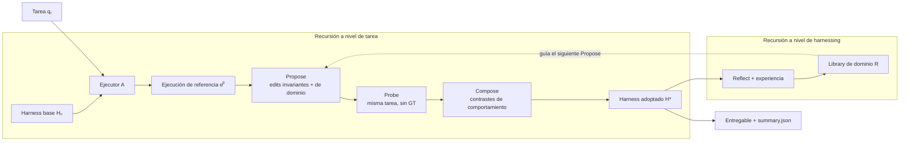
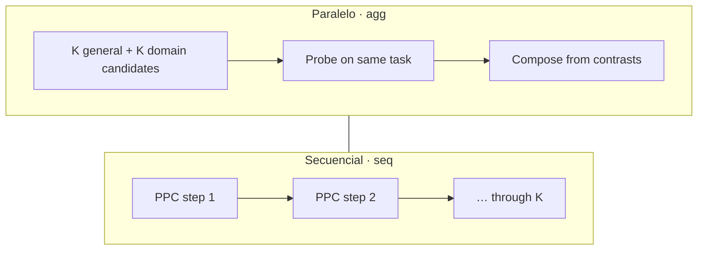
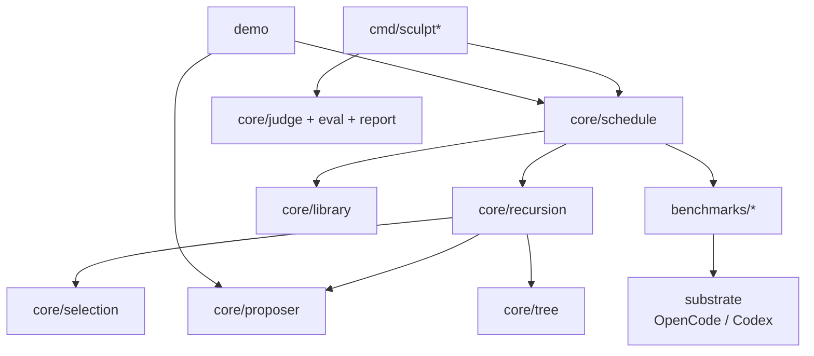

<p align="center">
  
</p>

<h1 align="center">Sculpt</h1>

<p align="center">
  <b>Harnessing recursivo de agentes en Go</b><br/>
  Refina el sistema <i>alrededor</i> de un modelo de pesos fijos — y recuerda lo que funcionó.
</p>

<p align="center">
  <a href="README.md">English</a> ·
  <a href="README.zh-CN.md">简体中文</a> ·
  <a href="README.ja.md">日本語</a> ·
  <a href="README.ko.md">한국어</a> ·
  <a href="README.es.md">Español</a> ·
  <a href="README.fr.md">Français</a> ·
  <a href="README.de.md">Deutsch</a> ·
  <a href="README.pt-BR.md">Português</a> ·
  <a href="docs/i18n/README.md">More</a>
</p>

<p align="center">
  <a href="https://github.com/linuslin-cto/Sculpt/stargazers"></a>
  <a href="https://github.com/linuslin-cto/Sculpt/network/members"></a>
  &nbsp;
  <a href="LICENSE"></a>
  <a href="https://go.dev/"></a>
  <a href="https://arxiv.org/abs/2610.14224"></a>
  <a href="docs/EVAL.md"></a>
  <a href="#autoevolución"></a>
</p>

<p align="center">
  <code>go test ./demo -run TestSelfEvolution</code>
  &nbsp;·&nbsp;
  <code>go run ./cmd/sculpt-demo --k 2</code>
  &nbsp;·&nbsp;
  <b>el bucle offline no necesita API keys</b>
</p>

---

Un **harness** es todo lo que envuelve a un modelo para que actúe como agente —
prompts, herramientas, memoria, skills, scripts, orquestación.

**Harnessing** es optimizar ese envoltorio **sin tocar los pesos del modelo**.

**Sculpt** es un framework Go para **harnessing recursivo de agentes** en un mundo abierto:
los agentes encuentran tareas nunca vistas al diseñar el harness. Mantiene los pesos fijos
y mejora el harness con dos bucles anidados — el mismo método que
[Harness²](https://github.com/google-research/harness2)
([paper](https://arxiv.org/abs/2610.14224)).

| | |
|---|---|
| **Nivel de tarea** | **Propose → Probe → Compose** contrastivo: edita, sonda en la *misma* tarea, compone desde contrastes de comportamiento — **sin feedback de ground truth** en el improver. |
| **Nivel de harnessing** | Persiste el harness adoptado + lecciones con evidencia en una **library** por dominio que guía la siguiente tarea. |

> Contrato offline (verificado): **base 0% → refined 100% (+100 pt)** en 100/100 rondas deterministas.
> Smoke de reparación Live DeepSeek: **100/100** con el mismo contrato Δ.

### Resultados destacados

| Señal | Valor |
|-------|-------|
| Autoevolución offline (determinista) | **base 0% → refined 100% (+100 pt)** · 100/100 |
| Smoke Live DeepSeek | **100/100** con el mismo contrato Δ |
| Picos del paper (cualitativos) | WorkBuddy **+11.5** · JobBench **+4.5** · LAB partial **+11.8 pp** |

## Por qué Sculpt

- **Pesos congelados** — todas las ganancias vienen del sistema alrededor del modelo.
- **El juez no se filtra al improver** — la selección es ciega al ground truth.
- **Nativo en Go** — seams tipados, tests rápidos, CLIs de un solo binario.
- Recursión **paralela y secuencial** (`agg` / `seq`) con presupuestos `R=4k` / `P=3k`.
- **Autoevolución medible** — juzga base vs refined y reporta Δ en puntos porcentuales.
- **Adapters listos** — JobBench, LAB, WorkBuddy-Bench (+ demo offline).

## Arquitectura

### Pipeline (tarea → library)



### Paralelo explora · secuencial profundiza



### Mapa de paquetes



### Ocho componentes editables

Alineados con el paper — la superficie que Sculpt lee, escribe y valida:

| Contexto | Bucle de herramientas | Orquestación |
|----------|------------------------|--------------|
| system prompt · guardrails · memory · skills | tool guidance · scripts | subagents · plugins |

## Contenidos

- [Por qué Sculpt](#por-qué-sculpt)
- [Arquitectura](#arquitectura)
- [Estado](#estado)
- [Instalación](#instalación)
- [Inicio rápido](#inicio-rápido)
- [Autoevolución](#autoevolución)
- [Benchmarks](#benchmarks)
- [Experimentos](#experimentos)
- [Layout](#layout)
- [Internacionalización](#internacionalización)
- [Cita](#cita)
- [Contribuir](#contribuir)
- [Licencia](#licencia)
- [Aviso](#aviso)

## Estado

| Área | Estado |
|------|--------|
| Demo offline + Propose–Probe–Compose | ✅ Ready |
| Tree · ledger · recursion · selection · schedule · library · judge | ✅ Ready |
| Resume / selection failure / rejudge-merge | ✅ Tested |
| Eval de autoevolución (`TestSelfEvolution*`) | ✅ Offline **+100 pt** |
| Smoke Live DeepSeek | ✅ **100/100** |
| CLI: `sculpt` · `sculpt-demo` · `sculpt-judge` · `sculpt-report` · `sculpt-check` | ✅ Ready |
| Adapters JobBench / LAB / WorkBuddy | ✅ Wired |
| Live Execute vía OpenCode / Codex | ⏳ Necesita checkouts + credenciales |

## Instalación

```bash
git clone https://github.com/linuslin-cto/Sculpt.git
cd Sculpt
go test ./...
```

**Requisitos**

- Go **1.22+**
- Python **3.x** en `PATH` (el ejecutor demo corre `scripts/summarize.py`)
- Ruta live opcional: OpenCode o Codex, datasets, `SCULPT_*` / keys de proveedor

Ver [docs/SETUP.md](docs/SETUP.md). Nunca commits de secretos — usa un `.env` gitignored.

## Inicio rápido

```bash
# Propose–Probe–Compose determinista (sin credenciales)
go run ./cmd/sculpt-demo --output runs/demo --k 2
go run ./cmd/sculpt-demo --output runs/demo-s7 --k 1 --seed 7

# Vista previa del stream de tareas
go run ./cmd/sculpt --bench demo --output runs/demo --k 1 --seed 7 --dry-run

# Puntuar autoevolución: refined + bases → Δ
go run ./cmd/sculpt-judge --bench demo --output runs/demo --k 1 --modes parallel
go run ./cmd/sculpt-judge --bench demo --output runs/demo --k 1 --bases
go run ./cmd/sculpt-report --bench demo --output runs/demo --k 1
```

Preflight:

```bash
go run ./cmd/sculpt-check --bench demo --output runs/check-demo
go run ./cmd/sculpt-check --bench jb --substrate oc --output runs/check-jb
```

## Autoevolución

Misma forma de evaluación que el demo / guía de experimentos de la investigación:

1. **Base falla** — `scripts/summarize.py` solo-positivos omite créditos.
2. **PPC a nivel de tarea** — propose · probe · compose sin leer `reference_answer.txt`.
3. **Nivel de harnessing** — harness adoptado + experiencia aterrizan en `library/` para la siguiente tarea.

```bash
go test ./demo -run TestSelfEvolution
```

| Etapa | Contrato offline |
|-------|------------------|
| Harness base | **0%** |
| Tras un paso PPC | **100%** |
| Δ | **+100 pt** |

Picos del paper en benches live (objetivos cualitativos, no gates de CI): WorkBuddy **+11.5**, JobBench **+4.5**, LAB partial **+11.8 pp** — ver [docs/EVAL.md](docs/EVAL.md).

## Benchmarks

| Benchmark | Alias | Enfoque |
|-----------|-------|---------|
| Demo offline | `demo` | Ledger / PPC determinista |
| JobBench | `jb` | Trabajo profesional |
| LAB | `lab` | Trabajo legal |
| WorkBuddy-Bench | `wb` | Office · web · code |

```bash
go run ./cmd/sculpt --bench demo --k 1 --seed 7 --dry-run
go run ./cmd/sculpt --bench jb --substrate oc --k 1 --modes parallel --dry-run
```

| Flag | Significado |
|------|-------------|
| `--k K` | Presupuesto de recursión (`R=4k` rollouts, `P=3k` sesiones improver) |
| `--modes parallel,sequential` | Namespaces `agg` / `seq` |
| `--substrate oc \| cx` | OpenCode o Codex |
| `--only-domains …` | Restringir dominios |
| `--max-tasks N` | Tope por dominio |
| `--dry-run` | Solo vista previa del stream |

Judge y report deben reutilizar el mismo bench, substrate, `--k`, modes y seed.

## Experimentos

| Opción | Comportamiento |
|--------|----------------|
| `--k 1` | Un paso Propose–Probe–Compose |
| `--k K --modes parallel` | Explora pools más anchos, luego compone |
| `--k K --modes sequential` | Refina más profundo en `K` pasos sucesivos |
| `--substrate cx` | Codex en lugar de OpenCode |

| Env | Rol |
|-----|-----|
| `SCULPT_PHASE_WIDTH` | Concurrencia Propose/rollout (default `2`) |
| `SCULPT_IMPROVER_MODEL` | Id del modelo improver (prefijo provider para OpenCode) |
| `SCULPT_SOLVER_MODEL` | Modelo solver para execute live |
| `SCULPT_RUNS_DIR` | Sobrescribe la raíz de runs |

Repite el mismo comando para **reanudar**. Usa una raíz de salida nueva al cambiar modelos o selección de tareas.

## Layout

| Ruta | Rol |
|------|-----|
| `core/tree` | Superficie de harness c1..c8 |
| `core/spec` | BenchSpec + seam del adapter |
| `core/ledger` | Identidad `R=4k` / `P=3k` |
| `core/recursion` | PPC paralelo + secuencial |
| `core/selection` | Elección ciega + reflexión |
| `core/schedule` | Namespaces · streams · dominios |
| `core/library` | Store de experiencia por dominio |
| `core/judge` · `eval` · `report` | Scores y Δ |
| `demo` | Adapter / proposer determinista |
| `benchmarks/*` | jb · lab · wb · discovery |
| `substrate` | Superficies OpenCode / Codex |
| `cmd/sculpt*` | CLIs |
| `docs/` | Setup · eval · i18n · notas del paper |

## Internacionalización

| Locale | Entrada |
|--------|---------|
| English | [README.md](README.md) |
| 简体中文 | [README.zh-CN.md](README.zh-CN.md) |
| 日本語 | [README.ja.md](README.ja.md) |
| 한국어 | [README.ko.md](README.ko.md) |
| Español | [README.es.md](README.es.md) |
| Français | [README.fr.md](README.fr.md) |
| Deutsch | [README.de.md](README.de.md) |
| Português (BR) | [README.pt-BR.md](README.pt-BR.md) |

Guía: [docs/i18n/README.md](docs/i18n/README.md).

**Regla:** no traduzcas comandos, rutas, flags ni nombres `SCULPT_*`.

## Cita

Si usas el método de harnessing recursivo, cita el trabajo original:

```bibtex
@article{xu2026harness2,
  title   = {Harness$^2$: Recursive Agent Harnessing for an Open World},
  author  = {Xu, Ruiyao and Chen, Yanfei and CuiZhu, Zhongying and Dalvi Mishra, Bhavana and Ming, Yifei and Yu, Han and Han, Rujun and Lee, Chen-Yu and Pfister, Tomas},
  journal = {arXiv preprint arXiv:2610.14224},
  year    = {2026},
  url     = {https://arxiv.org/abs/2610.14224}
}
```

## Contribuir

Ver [CONTRIBUTING.md](CONTRIBUTING.md). Traducciones: [docs/i18n/README.md](docs/i18n/README.md).

## Licencia

Apache **2.0** — ver [LICENSE](LICENSE).

Método upstream, benches y runners de terceros conservan sus propias licencias.
El árbol de investigación [harness2](https://github.com/google-research/harness2) **no** se redistribuye como superficie de producto de Sculpt.

## Aviso

Sculpt es un proyecto open-source independiente inspirado en investigación publicada.
**No** es un producto oficial de Google ni está afiliado a Google Research.
