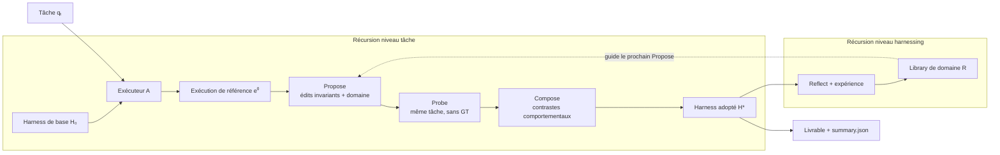
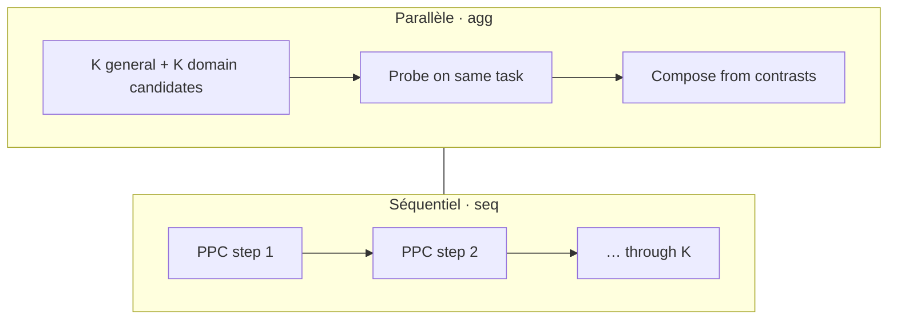
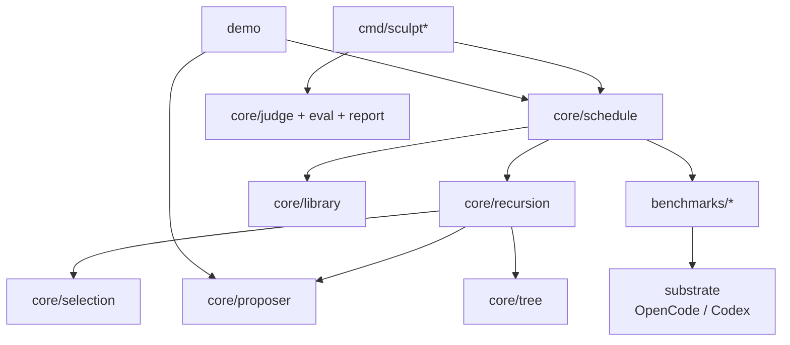

<p align="center">
  
</p>

<h1 align="center">Sculpt</h1>

<p align="center">
  <b>Harnessing récursif d'agents en Go</b><br/>
  Affine le système <i>autour</i> d'un modèle à poids fixes — puis mémorise ce qui a marché.
</p>

<p align="center">
  <a href="README.md">English</a> ·
  <a href="README.zh-CN.md">简体中文</a> ·
  <a href="README.ja.md">日本語</a> ·
  <a href="README.ko.md">한국어</a> ·
  <a href="README.es.md">Español</a> ·
  <a href="README.fr.md">Français</a> ·
  <a href="README.de.md">Deutsch</a> ·
  <a href="README.pt-BR.md">Português</a> ·
  <a href="docs/i18n/README.md">More</a>
</p>

<p align="center">
  <a href="https://github.com/linuslin-cto/Sculpt/stargazers"></a>
  <a href="https://github.com/linuslin-cto/Sculpt/network/members"></a>
  &nbsp;
  <a href="LICENSE"></a>
  <a href="https://go.dev/"></a>
  <a href="https://arxiv.org/abs/2610.14224"></a>
  <a href="docs/EVAL.md"></a>
  <a href="#auto-évolution"></a>
</p>

<p align="center">
  <code>go test ./demo -run TestSelfEvolution</code>
  &nbsp;·&nbsp;
  <code>go run ./cmd/sculpt-demo --k 2</code>
  &nbsp;·&nbsp;
  <b>aucune clé API pour la boucle offline</b>
</p>

---

Un **harness** est tout ce qui entoure un modèle pour qu'il agisse comme agent —
prompts, outils, mémoire, skills, scripts, orchestration.

Le **harnessing** optimise cette enveloppe **sans toucher aux poids du modèle**.

**Sculpt** est un framework Go de **harnessing récursif d'agents** en monde ouvert :
les agents rencontrent des tâches jamais vues à la conception du harness. Les poids restent
fixes ; deux boucles imbriquées améliorent le harness — la même méthode que
[Harness²](https://github.com/google-research/harness2)
([paper](https://arxiv.org/abs/2610.14224)).

| | |
|---|---|
| **Niveau tâche** | **Propose → Probe → Compose** contrastif : édite, sonde sur la *même* tâche, compose depuis des contrastes comportementaux — **sans feedback de vérité terrain** dans l'improver. |
| **Niveau harnessing** | Persiste le harness adopté + leçons étayées dans une **library** par domaine qui guide la tâche suivante. |

> Contrat offline (vérifié) : **base 0% → refined 100% (+100 pt)** sur 100/100 tours déterministes.
> Smoke de réparation Live DeepSeek : **100/100** sur le même contrat Δ.

### Résultats phares

| Signal | Valeur |
|--------|--------|
| Auto-évolution offline (déterministe) | **base 0% → refined 100% (+100 pt)** · 100/100 |
| Smoke Live DeepSeek | **100/100** sur le même contrat Δ |
| Pics du paper (qualitatifs) | WorkBuddy **+11.5** · JobBench **+4.5** · LAB partial **+11.8 pp** |

## Pourquoi Sculpt

- **Poids gelés** — tous les gains viennent du système autour du modèle.
- **Le juge ne fuit pas vers l'improver** — la sélection est aveugle à la vérité terrain.
- **Natif Go** — seams typés, tests rapides, CLIs mono-binaire.
- Récursion **parallèle et séquentielle** (`agg` / `seq`) avec budgets `R=4k` / `P=3k`.
- **Auto-évolution mesurable** — juge base vs refined, rapporte Δ en points de pourcentage.
- **Adapters prêts** — JobBench, LAB, WorkBuddy-Bench (+ demo offline).

## Architecture

### Pipeline (tâche → library)



### Le parallèle explore · le séquentiel approfondit



### Carte des packages



### Huit composants éditables

Alignés sur le paper — la surface que Sculpt lit, écrit et valide :

| Contexte | Boucle d'outils | Orchestration |
|----------|-----------------|---------------|
| system prompt · guardrails · memory · skills | tool guidance · scripts | subagents · plugins |

## Sommaire

- [Pourquoi Sculpt](#pourquoi-sculpt)
- [Architecture](#architecture)
- [État](#état)
- [Installation](#installation)
- [Démarrage rapide](#démarrage-rapide)
- [Auto-évolution](#auto-évolution)
- [Benchmarks](#benchmarks)
- [Expériences](#expériences)
- [Layout](#layout)
- [Internationalisation](#internationalisation)
- [Citation](#citation)
- [Contribuer](#contribuer)
- [Licence](#licence)
- [Avertissement](#avertissement)

## État

| Domaine | État |
|---------|------|
| Demo offline + Propose–Probe–Compose | ✅ Ready |
| Tree · ledger · recursion · selection · schedule · library · judge | ✅ Ready |
| Resume / selection failure / rejudge-merge | ✅ Tested |
| Eval d'auto-évolution (`TestSelfEvolution*`) | ✅ Offline **+100 pt** |
| Smoke Live DeepSeek | ✅ **100/100** |
| CLI: `sculpt` · `sculpt-demo` · `sculpt-judge` · `sculpt-report` · `sculpt-check` | ✅ Ready |
| Adapters JobBench / LAB / WorkBuddy | ✅ Wired |
| Live Execute via OpenCode / Codex | ⏳ Checkouts + credentials requis |

## Installation

```bash
git clone https://github.com/linuslin-cto/Sculpt.git
cd Sculpt
go test ./...
```

**Prérequis**

- Go **1.22+**
- Python **3.x** sur `PATH` (l'exécuteur demo lance `scripts/summarize.py`)
- Chemin live optionnel : OpenCode ou Codex, datasets, `SCULPT_*` / clés fournisseur

Voir [docs/SETUP.md](docs/SETUP.md). Ne committez jamais de secrets — utilisez un `.env` gitignoré.

## Démarrage rapide

```bash
# Propose–Probe–Compose déterministe (sans credentials)
go run ./cmd/sculpt-demo --output runs/demo --k 2
go run ./cmd/sculpt-demo --output runs/demo-s7 --k 1 --seed 7

# Aperçu du flux de tâches
go run ./cmd/sculpt --bench demo --output runs/demo --k 1 --seed 7 --dry-run

# Scorer l'auto-évolution : refined + bases → Δ
go run ./cmd/sculpt-judge --bench demo --output runs/demo --k 1 --modes parallel
go run ./cmd/sculpt-judge --bench demo --output runs/demo --k 1 --bases
go run ./cmd/sculpt-report --bench demo --output runs/demo --k 1
```

Préflight :

```bash
go run ./cmd/sculpt-check --bench demo --output runs/check-demo
go run ./cmd/sculpt-check --bench jb --substrate oc --output runs/check-jb
```

## Auto-évolution

Même forme d'évaluation que le demo / guide d'expériences de la recherche :

1. **La base échoue** — `scripts/summarize.py` additif positif omet les crédits.
2. **PPC niveau tâche** — propose · probe · compose sans lire `reference_answer.txt`.
3. **Niveau harnessing** — harness adopté + expérience atterrissent dans `library/` pour la suite.

```bash
go test ./demo -run TestSelfEvolution
```

| Étape | Contrat offline |
|-------|-----------------|
| Harness de base | **0%** |
| Après un pas PPC | **100%** |
| Δ | **+100 pt** |

Pics du paper sur benches live (cibles qualitatives, pas des gates CI) : WorkBuddy **+11.5**, JobBench **+4.5**, LAB partial **+11.8 pp** — voir [docs/EVAL.md](docs/EVAL.md).

## Benchmarks

| Benchmark | Alias | Focus |
|-----------|-------|-------|
| Demo offline | `demo` | Ledger / PPC déterministe |
| JobBench | `jb` | Travail professionnel |
| LAB | `lab` | Travail juridique |
| WorkBuddy-Bench | `wb` | Office · web · code |

```bash
go run ./cmd/sculpt --bench demo --k 1 --seed 7 --dry-run
go run ./cmd/sculpt --bench jb --substrate oc --k 1 --modes parallel --dry-run
```

| Flag | Signification |
|------|---------------|
| `--k K` | Budget de récursion (`R=4k` rollouts, `P=3k` sessions improver) |
| `--modes parallel,sequential` | Namespaces `agg` / `seq` |
| `--substrate oc \| cx` | OpenCode ou Codex |
| `--only-domains …` | Restreindre les domaines |
| `--max-tasks N` | Plafond par domaine |
| `--dry-run` | Aperçu du flux uniquement |

Judge et report doivent réutiliser le même bench, substrate, `--k`, modes et seed.

## Expériences

| Option | Comportement |
|--------|--------------|
| `--k 1` | Un pas Propose–Probe–Compose |
| `--k K --modes parallel` | Explore des pools plus larges, puis compose |
| `--k K --modes sequential` | Affine plus profondément sur `K` pas successifs |
| `--substrate cx` | Codex à la place d'OpenCode |

| Env | Rôle |
|-----|------|
| `SCULPT_PHASE_WIDTH` | Concurrence Propose/rollout (défaut `2`) |
| `SCULPT_IMPROVER_MODEL` | Id modèle improver (préfixe provider pour OpenCode) |
| `SCULPT_SOLVER_MODEL` | Modèle solver pour l'execute live |
| `SCULPT_RUNS_DIR` | Remplace la racine des runs |

Répétez la même commande pour **reprendre**. Utilisez une nouvelle racine de sortie si vous changez modèles ou sélection de tâches.

## Layout

| Chemin | Rôle |
|--------|------|
| `core/tree` | Surface harness c1..c8 |
| `core/spec` | BenchSpec + seam adapter |
| `core/ledger` | Identité `R=4k` / `P=3k` |
| `core/recursion` | PPC parallèle + séquentielle |
| `core/selection` | Choix aveugle + réflexion |
| `core/schedule` | Namespaces · streams · domaines |
| `core/library` | Store d'expérience par domaine |
| `core/judge` · `eval` · `report` | Scores et Δ |
| `demo` | Adapter / proposer déterministe |
| `benchmarks/*` | jb · lab · wb · discovery |
| `substrate` | Surfaces OpenCode / Codex |
| `cmd/sculpt*` | CLIs |
| `docs/` | Setup · eval · i18n · notes paper |

## Internationalisation

| Locale | Entrée |
|--------|--------|
| English | [README.md](README.md) |
| 简体中文 | [README.zh-CN.md](README.zh-CN.md) |
| 日本語 | [README.ja.md](README.ja.md) |
| 한국어 | [README.ko.md](README.ko.md) |
| Español | [README.es.md](README.es.md) |
| Français | [README.fr.md](README.fr.md) |
| Deutsch | [README.de.md](README.de.md) |
| Português (BR) | [README.pt-BR.md](README.pt-BR.md) |

Guide : [docs/i18n/README.md](docs/i18n/README.md).

**Règle :** ne traduisez pas commandes, chemins, flags ni noms `SCULPT_*`.

## Citation

Si vous utilisez la méthode de harnessing récursif, citez l'œuvre originale :

```bibtex
@article{xu2026harness2,
  title   = {Harness$^2$: Recursive Agent Harnessing for an Open World},
  author  = {Xu, Ruiyao and Chen, Yanfei and CuiZhu, Zhongying and Dalvi Mishra, Bhavana and Ming, Yifei and Yu, Han and Han, Rujun and Lee, Chen-Yu and Pfister, Tomas},
  journal = {arXiv preprint arXiv:2610.14224},
  year    = {2026},
  url     = {https://arxiv.org/abs/2610.14224}
}
```

## Contribuer

Voir [CONTRIBUTING.md](CONTRIBUTING.md). Traductions : [docs/i18n/README.md](docs/i18n/README.md).

## Licence

Apache **2.0** — voir [LICENSE](LICENSE).

Méthode upstream, benches et runners tiers conservent leurs licences.
L'arbre de recherche [harness2](https://github.com/google-research/harness2) n'est **pas** redistribué comme surface produit de Sculpt.

## Avertissement

Sculpt est un projet open-source indépendant inspiré par de la recherche publiée.
Ce n'est **pas** un produit officiel Google et il n'est pas affilié à Google Research.
