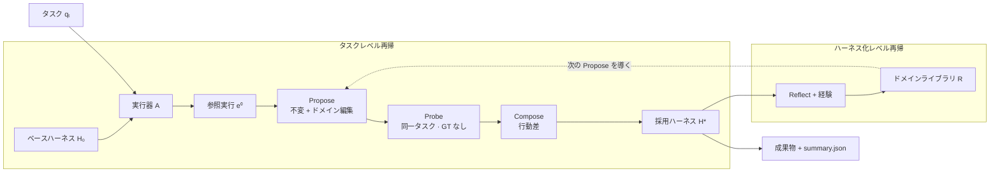
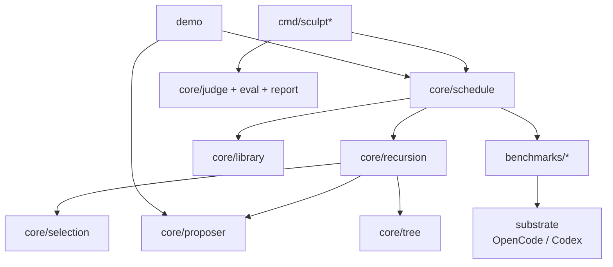

<p align="center">
  
</p>

<h1 align="center">Sculpt</h1>

<p align="center">
  <b>Go による再帰的エージェント・ハーネス化</b><br/>
  重み固定モデルの<em>周囲</em>を磨き、うまくいった仕組みを記憶する。
</p>

<p align="center">
  <a href="README.md">English</a> ·
  <a href="README.zh-CN.md">简体中文</a> ·
  <a href="README.ja.md">日本語</a> ·
  <a href="README.ko.md">한국어</a> ·
  <a href="README.es.md">Español</a> ·
  <a href="README.fr.md">Français</a> ·
  <a href="README.de.md">Deutsch</a> ·
  <a href="README.pt-BR.md">Português</a> ·
  <a href="docs/i18n/README.md">More</a>
</p>

<p align="center">
  <a href="LICENSE"></a>
  <a href="https://go.dev/"></a>
  <a href="https://arxiv.org/abs/2610.14224"></a>
  <a href="docs/EVAL.md"></a>
  <a href="#自己進化"></a>
</p>

<p align="center">
  <code>go test ./demo -run TestSelfEvolution</code>
  &nbsp;·&nbsp;
  <code>go run ./cmd/sculpt-demo --k 2</code>
  &nbsp;·&nbsp;
  <b>オフライン閉ループに API キーは不要</b>
</p>

---

**ハーネス**は、モデルをエージェントとして動かす周囲の一式です —
プロンプト、ツール、メモリ、スキル、スクリプト、オーケストレーション。

**ハーネス化**は、**モデル重みに触れず**その周囲を最適化することです。

**Sculpt** はオープンワールド向けの Go フレームワークです。設計時に見なかったタスクにも出会い、
重みを固定したまま二層の再帰でハーネスを改善します —
[Harness²](https://github.com/google-research/harness2)
（[論文](https://arxiv.org/abs/2610.14224)）と同じ方法です。

| | |
|---|---|
| **タスクレベル** | 対照的な **Propose → Probe → Compose**：編集し、同一タスクでプローブし、行動差から合成 — 改善ループに**真値フィードバックなし**。 |
| **ハーネス化レベル** | 採用ハーネスと根拠付き教訓をドメイン別 **library** に残し、次タスクを導く。 |

> オフライン契約（検証済）：**base 0% → refined 100%（+100 pt）**、決定的 100/100。
> Live DeepSeek 修復スモーク：同じ Δ 契約で **100/100**。

## なぜ Sculpt か

- **重みは凍結** — 改善はすべてモデル周囲から。
- **採点器は改善器に漏れない** — 選択は真値に盲目。
- **Go ネイティブ** — 型付きシーム、高速テスト、単一バイナリ CLI。
- **並列と直列** 再帰（`agg` / `seq`）、明示的な `R=4k` / `P=3k`。
- **測れる自己進化** — base と refined を別判定し、百分点 Δ を報告。
- **ベンチ対応** — JobBench、LAB、WorkBuddy-Bench（＋オフライン demo）。

## アーキテクチャ

### パイプライン（タスク → ライブラリ）



### パッケージマップ



### 8 つの編集可能コンポーネント

方法論文と揃えた、Sculpt が読み書き・検証する面：

| 文脈 | ツールループ | オーケストレーション |
|------|--------------|----------------------|
| system prompt · guardrails · memory · skills | tool guidance · scripts | subagents · plugins |

## 目次

- [なぜ Sculpt か](#なぜ-sculpt-か)
- [アーキテクチャ](#アーキテクチャ)
- [ステータス](#ステータス)
- [インストール](#インストール)
- [クイックスタート](#クイックスタート)
- [自己進化](#自己進化)
- [ベンチマーク](#ベンチマーク)
- [実験](#実験)
- [レイアウト](#レイアウト)
- [国際化](#国際化)
- [引用](#引用)
- [貢献](#貢献)
- [ライセンス](#ライセンス)
- [免責](#免責)

## ステータス

| 領域 | 状態 |
|------|------|
| オフライン demo + Propose–Probe–Compose | ✅ Ready |
| Tree · ledger · recursion · selection · schedule · library · judge | ✅ Ready |
| Resume / selection failure / rejudge-merge | ✅ Tested |
| 自己進化評価（`TestSelfEvolution*`） | ✅ オフライン **+100 pt** |
| Live DeepSeek 修復スモーク | ✅ **100/100** |
| CLI: `sculpt` · `sculpt-demo` · `sculpt-judge` · `sculpt-report` · `sculpt-check` | ✅ Ready |
| JobBench / LAB / WorkBuddy アダプタ | ✅ Wired |
| OpenCode / Codex による Live Execute | ⏳ checkout + 資格情報が必要 |

## インストール

```bash
git clone https://github.com/linuslin-cto/Sculpt.git
cd Sculpt
go test ./...
```

**要件**

- Go **1.22+**
- `PATH` 上の Python **3.x**（demo 実行器が `scripts/summarize.py` を実行）
- 任意のライブ経路：OpenCode または Codex、データセット、`SCULPT_*` / プロバイダキー

詳細は [docs/SETUP.md](docs/SETUP.md)。秘密情報はコミットしないでください — gitignore された `.env` を使います。

## クイックスタート

```bash
# 決定的 Propose–Probe–Compose（資格情報不要）
go run ./cmd/sculpt-demo --output runs/demo --k 2
go run ./cmd/sculpt-demo --output runs/demo-s7 --k 1 --seed 7

# タスクストリームのプレビュー
go run ./cmd/sculpt --bench demo --output runs/demo --k 1 --seed 7 --dry-run

# 自己進化の採点：refined + bases → Δ
go run ./cmd/sculpt-judge --bench demo --output runs/demo --k 1 --modes parallel
go run ./cmd/sculpt-judge --bench demo --output runs/demo --k 1 --bases
go run ./cmd/sculpt-report --bench demo --output runs/demo --k 1
```

事前チェック：

```bash
go run ./cmd/sculpt-check --bench demo --output runs/check-demo
go run ./cmd/sculpt-check --bench jb --substrate oc --output runs/check-jb
```

## 自己進化

研究デモ / 実験ガイドと同じ評価形：

1. **ベース失敗** — 正の加算のみの `scripts/summarize.py` が貸方を落とす。
2. **タスクレベル PPC** — `reference_answer.txt` を読まず propose · probe · compose。
3. **ハーネス化レベル** — 採用ハーネスと経験が `library/` に入り次タスクを導く。

```bash
go test ./demo -run TestSelfEvolution
```

| 段階 | オフライン契約 |
|------|----------------|
| ベースハーネス | **0%** |
| 1 回の PPC 後 | **100%** |
| Δ | **+100 pt** |

ライブベンチの論文ピーク（定性目標、CI ゲートではない）：WorkBuddy **+11.5**、JobBench **+4.5**、LAB partial **+11.8 pp** — [docs/EVAL.md](docs/EVAL.md)。

## ベンチマーク

| ベンチマーク | 別名 | 焦点 |
|--------------|------|------|
| オフライン demo | `demo` | 決定的 ledger / PPC |
| JobBench | `jb` | 専門業務 |
| LAB | `lab` | 法律業務 |
| WorkBuddy-Bench | `wb` | Office · web · code |

```bash
go run ./cmd/sculpt --bench demo --k 1 --seed 7 --dry-run
go run ./cmd/sculpt --bench jb --substrate oc --k 1 --modes parallel --dry-run
```

| フラグ | 意味 |
|--------|------|
| `--k K` | 再帰予算（`R=4k` rollouts、`P=3k` improver sessions） |
| `--modes parallel,sequential` | `agg` / `seq` 名前空間 |
| `--substrate oc \| cx` | OpenCode または Codex |
| `--only-domains …` | ドメイン制限 |
| `--max-tasks N` | ドメインあたり上限 |
| `--dry-run` | ストリームプレビューのみ |

judge / report は同じ bench、substrate、`--k`、modes、seed を再利用してください。

## 実験

| オプション | 挙動 |
|------------|------|
| `--k 1` | 1 回の Propose–Probe–Compose |
| `--k K --modes parallel` | より広い候補を探り、合成 |
| `--k K --modes sequential` | `K` 連続ステップでより深く精錬 |
| `--substrate cx` | Codex を使用 |

| 環境変数 | 役割 |
|----------|------|
| `SCULPT_PHASE_WIDTH` | Propose/rollout 並列度（既定 `2`） |
| `SCULPT_IMPROVER_MODEL` | 改善器モデル id（OpenCode は provider 接頭辞） |
| `SCULPT_SOLVER_MODEL` | ライブ実行のソルバモデル |
| `SCULPT_RUNS_DIR` | runs ルートの上書き |

同じコマンドを繰り返すと **再開** します。モデルやタスク選択を変えるときは新しい出力ルートを使ってください。

## レイアウト

| パス | 役割 |
|------|------|
| `core/tree` | c1..c8 ハーネス面 |
| `core/spec` | BenchSpec + アダプタシーム |
| `core/ledger` | `R=4k` / `P=3k` 恒等式 |
| `core/recursion` | 並列 + 直列 PPC |
| `core/selection` | 盲目選択 + 反省 |
| `core/schedule` | 名前空間 · ストリーム · ドメイン |
| `core/library` | ドメイン別経験ストア |
| `core/judge` · `eval` · `report` | スコアと Δ |
| `demo` | 決定的アダプタ / proposer |
| `benchmarks/*` | jb · lab · wb · discovery |
| `substrate` | OpenCode / Codex 面 |
| `cmd/sculpt*` | CLI |
| `docs/` | Setup · eval · i18n · 論文ノート |

## 国際化

| ロケール | 入口 |
|----------|------|
| English | [README.md](README.md) |
| 简体中文 | [README.zh-CN.md](README.zh-CN.md) |
| 日本語 | [README.ja.md](README.ja.md) |
| 한국어 | [README.ko.md](README.ko.md) |
| Español | [README.es.md](README.es.md) |
| Français | [README.fr.md](README.fr.md) |
| Deutsch | [README.de.md](README.de.md) |
| Português (BR) | [README.pt-BR.md](README.pt-BR.md) |

ガイド：[docs/i18n/README.md](docs/i18n/README.md)。

**規則：** コマンド、パス、フラグ、`SCULPT_*` 名は翻訳しない。

## 引用

再帰的ハーネス化手法を使う場合は原著を引用してください：

```bibtex
@article{xu2026harness2,
  title   = {Harness$^2$: Recursive Agent Harnessing for an Open World},
  author  = {Xu, Ruiyao and Chen, Yanfei and CuiZhu, Zhongying and Dalvi Mishra, Bhavana and Ming, Yifei and Yu, Han and Han, Rujun and Lee, Chen-Yu and Pfister, Tomas},
  journal = {arXiv preprint arXiv:2610.14224},
  year    = {2026},
  url     = {https://arxiv.org/abs/2610.14224}
}
```

## 貢献

[CONTRIBUTING.md](CONTRIBUTING.md) を参照。翻訳は [docs/i18n/README.md](docs/i18n/README.md)。

## ライセンス

Apache **2.0** — [LICENSE](LICENSE)。

上流の手法・ベンチ・サードパーティ runner は各自のライセンスを保持します。
[harness2](https://github.com/google-research/harness2) 研究ツリーは Sculpt の製品面として再配布しません。

## 免責

Sculpt は公開研究に着想を得た独立のオープンソースプロジェクトです。
Google の公式製品ではなく、Google Research との提携もありません。
