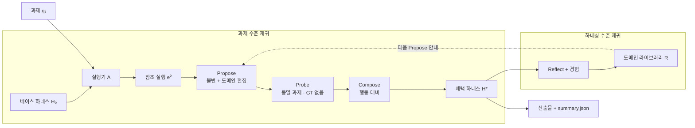
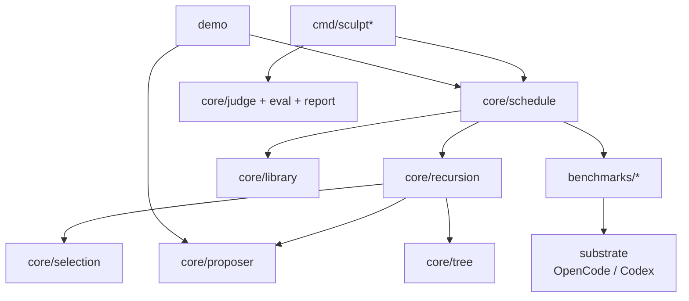

<p align="center">
  
</p>

<h1 align="center">Sculpt</h1>

<p align="center">
  <b>Go로 구현한 재귀적 에이전트 하네싱</b><br/>
  가중치가 고정된 모델의 <i>주변</i> 시스템을 다듬고, 효과 있던 것을 기억합니다.
</p>

<p align="center">
  <a href="README.md">English</a> ·
  <a href="README.zh-CN.md">简体中文</a> ·
  <a href="README.ja.md">日本語</a> ·
  <a href="README.ko.md">한국어</a> ·
  <a href="README.es.md">Español</a> ·
  <a href="README.fr.md">Français</a> ·
  <a href="README.de.md">Deutsch</a> ·
  <a href="README.pt-BR.md">Português</a> ·
  <a href="docs/i18n/README.md">More</a>
</p>

<p align="center">
  <a href="LICENSE"></a>
  <a href="https://go.dev/"></a>
  <a href="https://arxiv.org/abs/2610.14224"></a>
  <a href="docs/EVAL.md"></a>
  <a href="#자기-진화"></a>
</p>

<p align="center">
  <code>go test ./demo -run TestSelfEvolution</code>
  &nbsp;·&nbsp;
  <code>go run ./cmd/sculpt-demo --k 2</code>
  &nbsp;·&nbsp;
  <b>오프라인 루프에는 API 키가 필요 없습니다</b>
</p>

---

**하네스**는 모델이 에이전트로 동작하도록 감싸는 전체 시스템입니다 —
프롬프트, 도구, 메모리, 스킬, 스크립트, 오케스트레이션.

**하네싱**은 **모델 가중치를 건드리지 않고** 그 래퍼를 최적화하는 과정입니다.

**Sculpt**는 개방 세계를 위한 Go 프레임워크입니다. 설계 당시 보지 못한 과제를 만나도
가중치를 고정한 채 두 겹의 재귀로 하네스를 개선합니다 —
[Harness²](https://github.com/google-research/harness2)
([논문](https://arxiv.org/abs/2610.14224))와 같은 방법입니다.

| | |
|---|---|
| **과제 수준** | 대조적 **Propose → Probe → Compose**: 하네스를 편집하고, *같은* 과제에서 탐침하며, 행동 대비로 합성 — 개선 루프에 **정답 피드백 없음**. |
| **하네싱 수준** | 채택된 하네스와 근거 있는 교훈을 도메인별 **library**에 남겨 다음 과제를 안내. |

> 오프라인 계약(검증됨): **base 0% → refined 100% (+100 pt)**, 결정적 100/100.
> Live DeepSeek 수리 스모크: 동일 Δ 계약에서 **100/100**.

## 왜 Sculpt인가

- **가중치 동결** — 이득은 모두 모델 주변에서 옵니다.
- **채점기가 개선기에 누수되지 않음** — 선택은 정답에 맹목입니다.
- **Go 네이티브** — 타입 시임, 빠른 테스트, 단일 바이너리 CLI.
- **병렬과 순차** 재귀(`agg` / `seq`), 명시적 `R=4k` / `P=3k`.
- **측정 가능한 자기 진화** — base와 refined를 따로 채점하고 Δ(pp)를 보고.
- **벤치 어댑터 준비** — JobBench, LAB, WorkBuddy-Bench(+ 오프라인 demo).

## 아키텍처

### 파이프라인 (과제 → 라이브러리)



### 패키지 맵



### 여덟 가지 편집 가능 구성 요소

방법 논문과 정렬 — Sculpt가 읽고 쓰고 검증하는 표면:

| 컨텍스트 | 도구 루프 | 오케스트레이션 |
|----------|-----------|----------------|
| system prompt · guardrails · memory · skills | tool guidance · scripts | subagents · plugins |

## 목차

- [왜 Sculpt인가](#왜-sculpt인가)
- [아키텍처](#아키텍처)
- [상태](#상태)
- [설치](#설치)
- [빠른 시작](#빠른-시작)
- [자기 진화](#자기-진화)
- [벤치마크](#벤치마크)
- [실험](#실험)
- [레이아웃](#레이아웃)
- [국제화](#국제화)
- [인용](#인용)
- [기여](#기여)
- [라이선스](#라이선스)
- [면책](#면책)

## 상태

| 영역 | 상태 |
|------|------|
| 오프라인 demo + Propose–Probe–Compose | ✅ Ready |
| Tree · ledger · recursion · selection · schedule · library · judge | ✅ Ready |
| Resume / selection failure / rejudge-merge | ✅ Tested |
| 자기 진화 평가(`TestSelfEvolution*`) | ✅ 오프라인 **+100 pt** |
| Live DeepSeek 수리 스모크 | ✅ **100/100** |
| CLI: `sculpt` · `sculpt-demo` · `sculpt-judge` · `sculpt-report` · `sculpt-check` | ✅ Ready |
| JobBench / LAB / WorkBuddy 어댑터 | ✅ Wired |
| OpenCode / Codex Live Execute | ⏳ checkout + 자격 증명 필요 |

## 설치

```bash
git clone https://github.com/linuslin-cto/Sculpt.git
cd Sculpt
go test ./...
```

**요구 사항**

- Go **1.22+**
- `PATH`의 Python **3.x** (demo 실행기가 `scripts/summarize.py` 실행)
- 선택적 라이브 경로: OpenCode 또는 Codex, 데이터셋, `SCULPT_*` / 프로바이더 키

[docs/SETUP.md](docs/SETUP.md) 참고. 비밀은 커밋하지 마세요 — gitignore된 `.env`를 사용하세요.

## 빠른 시작

```bash
# 결정적 Propose–Probe–Compose (자격 증명 불필요)
go run ./cmd/sculpt-demo --output runs/demo --k 2
go run ./cmd/sculpt-demo --output runs/demo-s7 --k 1 --seed 7

# 과제 스트림 미리보기
go run ./cmd/sculpt --bench demo --output runs/demo --k 1 --seed 7 --dry-run

# 자기 진화 점수: refined + bases → Δ
go run ./cmd/sculpt-judge --bench demo --output runs/demo --k 1 --modes parallel
go run ./cmd/sculpt-judge --bench demo --output runs/demo --k 1 --bases
go run ./cmd/sculpt-report --bench demo --output runs/demo --k 1
```

사전 점검:

```bash
go run ./cmd/sculpt-check --bench demo --output runs/check-demo
go run ./cmd/sculpt-check --bench jb --substrate oc --output runs/check-jb
```

## 자기 진화

연구 데모 / 실험 가이드와 같은 평가 형태:

1. **베이스 실패** — 양수만 더하는 `scripts/summarize.py`가 대변을 누락.
2. **과제 수준 PPC** — `reference_answer.txt`를 읽지 않고 propose · probe · compose.
3. **하네싱 수준** — 채택 하네스와 경험이 `library/`에 들어가 다음 과제를 안내.

```bash
go test ./demo -run TestSelfEvolution
```

| 단계 | 오프라인 계약 |
|------|----------------|
| 베이스 하네스 | **0%** |
| PPC 1회 후 | **100%** |
| Δ | **+100 pt** |

라이브 벤치 논문 피크(정성 목표, CI 게이트 아님): WorkBuddy **+11.5**, JobBench **+4.5**, LAB partial **+11.8 pp** — [docs/EVAL.md](docs/EVAL.md).

## 벤치마크

| 벤치마크 | 별칭 | 초점 |
|----------|------|------|
| 오프라인 demo | `demo` | 결정적 ledger / PPC |
| JobBench | `jb` | 전문 업무 |
| LAB | `lab` | 법률 업무 |
| WorkBuddy-Bench | `wb` | Office · web · code |

```bash
go run ./cmd/sculpt --bench demo --k 1 --seed 7 --dry-run
go run ./cmd/sculpt --bench jb --substrate oc --k 1 --modes parallel --dry-run
```

| 플래그 | 의미 |
|--------|------|
| `--k K` | 재귀 예산 (`R=4k` rollouts, `P=3k` improver sessions) |
| `--modes parallel,sequential` | `agg` / `seq` 네임스페이스 |
| `--substrate oc \| cx` | OpenCode 또는 Codex |
| `--only-domains …` | 도메인 제한 |
| `--max-tasks N` | 도메인당 상한 |
| `--dry-run` | 스트림 미리보기만 |

judge와 report는 동일한 bench, substrate, `--k`, modes, seed를 재사용해야 합니다.

## 실험

| 옵션 | 동작 |
|------|------|
| `--k 1` | Propose–Probe–Compose 1회 |
| `--k K --modes parallel` | 더 넓은 후보를 탐침한 뒤 합성 |
| `--k K --modes sequential` | `K`번 연속으로 더 깊게 정제 |
| `--substrate cx` | Codex 사용 |

| 환경 변수 | 역할 |
|-----------|------|
| `SCULPT_PHASE_WIDTH` | Propose/rollout 동시성 (기본 `2`) |
| `SCULPT_IMPROVER_MODEL` | 개선기 모델 id (OpenCode는 provider 접두사) |
| `SCULPT_SOLVER_MODEL` | 라이브 실행 솔버 모델 |
| `SCULPT_RUNS_DIR` | runs 루트 재정의 |

같은 명령을 반복하면 **재개**됩니다. 모델이나 과제 선택을 바꿀 때는 새 출력 루트를 쓰세요.

## 레이아웃

| 경로 | 역할 |
|------|------|
| `core/tree` | c1..c8 하네스 표면 |
| `core/spec` | BenchSpec + 어댑터 시임 |
| `core/ledger` | `R=4k` / `P=3k` 항등식 |
| `core/recursion` | 병렬 + 순차 PPC |
| `core/selection` | 맹목 선택 + 성찰 |
| `core/schedule` | 네임스페이스 · 스트림 · 도메인 |
| `core/library` | 도메인별 경험 저장소 |
| `core/judge` · `eval` · `report` | 점수와 Δ |
| `demo` | 결정적 어댑터 / proposer |
| `benchmarks/*` | jb · lab · wb · discovery |
| `substrate` | OpenCode / Codex 표면 |
| `cmd/sculpt*` | CLI |
| `docs/` | Setup · eval · i18n · 논문 노트 |

## 국제화

| 로케일 | 진입점 |
|--------|--------|
| English | [README.md](README.md) |
| 简体中文 | [README.zh-CN.md](README.zh-CN.md) |
| 日本語 | [README.ja.md](README.ja.md) |
| 한국어 | [README.ko.md](README.ko.md) |
| Español | [README.es.md](README.es.md) |
| Français | [README.fr.md](README.fr.md) |
| Deutsch | [README.de.md](README.de.md) |
| Português (BR) | [README.pt-BR.md](README.pt-BR.md) |

가이드: [docs/i18n/README.md](docs/i18n/README.md).

**규칙:** 명령, 경로, 플래그, `SCULPT_*` 이름은 번역하지 마세요.

## 인용

재귀적 하네싱 방법을 사용할 경우 원작을 인용해 주세요:

```bibtex
@article{xu2026harness2,
  title   = {Harness$^2$: Recursive Agent Harnessing for an Open World},
  author  = {Xu, Ruiyao and Chen, Yanfei and CuiZhu, Zhongying and Dalvi Mishra, Bhavana and Ming, Yifei and Yu, Han and Han, Rujun and Lee, Chen-Yu and Pfister, Tomas},
  journal = {arXiv preprint arXiv:2610.14224},
  year    = {2026},
  url     = {https://arxiv.org/abs/2610.14224}
}
```

## 기여

[CONTRIBUTING.md](CONTRIBUTING.md) 참고. 번역은 [docs/i18n/README.md](docs/i18n/README.md).

## 라이선스

Apache **2.0** — [LICENSE](LICENSE).

업스트림 방법·벤치·서드파티 runner는 각자의 라이선스를 유지합니다.
[harness2](https://github.com/google-research/harness2) 연구 트리는 Sculpt 제품 면으로 재배포하지 않습니다.

## 면책

Sculpt는 공개 연구에서 영감을 받은 독립 오픈소스 프로젝트입니다.
Google 공식 제품이 아니며 Google Research와 제휴 관계도 없습니다.
