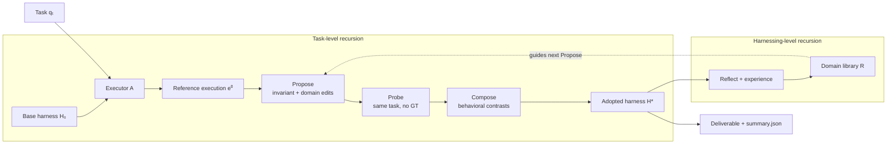
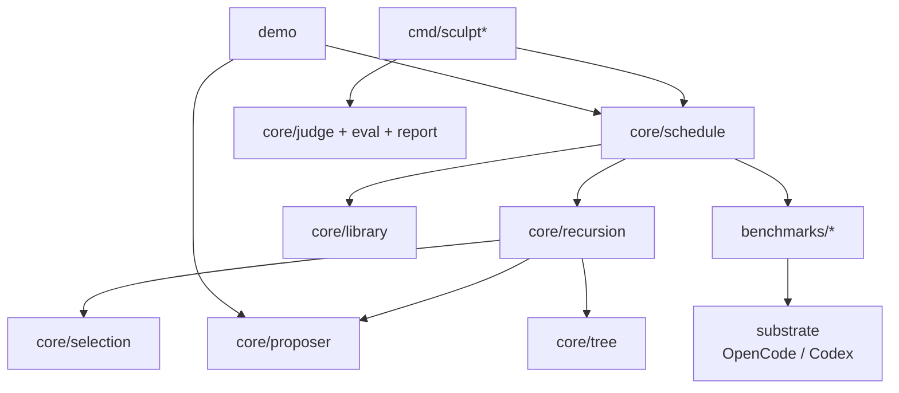

<p align="center">
  
</p>

<h1 align="center">Sculpt</h1>

<p align="center">
  <b>Recursive agent harnessing in Go</b><br/>
  Refine the system <i>around</i> a fixed-weight model — then remember what worked.
</p>

<p align="center">
  <a href="README.md">English</a> ·
  <a href="README.zh-CN.md">简体中文</a> ·
  <a href="README.ja.md">日本語</a> ·
  <a href="README.ko.md">한국어</a> ·
  <a href="README.es.md">Español</a> ·
  <a href="README.fr.md">Français</a> ·
  <a href="README.de.md">Deutsch</a> ·
  <a href="README.pt-BR.md">Português</a> ·
  <a href="docs/i18n/README.md">More</a>
</p>

<p align="center">
  <a href="LICENSE"></a>
  <a href="https://go.dev/"></a>
  <a href="https://arxiv.org/abs/2610.14224"></a>
  <a href="docs/EVAL.md"></a>
  <a href="#self-evolution"></a>
</p>

<p align="center">
  <code>go test ./demo -run TestSelfEvolution</code>
  &nbsp;·&nbsp;
  <code>go run ./cmd/sculpt-demo --k 2</code>
  &nbsp;·&nbsp;
  <b>no API keys required for the offline loop</b>
</p>

---

A **harness** is everything wrapped around a model so it can act as an agent —
prompts, tools, memory, skills, scripts, orchestration.

**Harnessing** is optimizing that wrapper **without touching model weights**.

**Sculpt** is a Go framework for **recursive agent harnessing** in an open world:
agents meet tasks that were never seen when the harness was designed. It keeps
weights fixed and improves the harness through two nested loops — the same
method popularized by
[Harness²](https://github.com/google-research/harness2)
([paper](https://arxiv.org/abs/2610.14224)).

| | |
|---|---|
| **Task-level** | Contrastive **Propose → Probe → Compose**: edit the harness, probe on the *same* task, compose from behavioral contrasts — **no ground-truth feedback** in the improver loop. |
| **Harnessing-level** | Persist the adopted harness + evidence-backed lessons in a per-domain **library** that guides the next task. |

> Offline contract (verified): **base 0% → refined 100% (+100 pt)** across 100/100 deterministic rounds.
> Live DeepSeek repair smoke: **100/100** on the same Δ contract.

## Why Sculpt

- **Weights stay frozen** — all gains come from the system around the model.
- **No grader leaks into improvers** — selection is blind to ground truth.
- **Go-native** — typed seams (`BenchmarkAdapter`, substrates), fast tests, single binary CLIs.
- **Parallel *and* sequential** recursion (`agg` / `seq`) with explicit `R=4k` / `P=3k` budgets.
- **Measurable self-evolution** — judge bases vs refined, report Δ in percentage points.
- **Bench-ready adapters** — JobBench, LAB, WorkBuddy-Bench (+ offline demo).

## Architecture

### Pipeline (task → library)



### Package map



### Eight editable components

Aligned with the method paper — the surface Sculpt reads, writes, and validates:

| Context | Tool loop | Orchestration |
|---------|-----------|---------------|
| system prompt · guardrails · memory · skills | tool guidance · scripts | subagents · plugins |

## Contents

- [Why Sculpt](#why-sculpt)
- [Architecture](#architecture)
- [Status](#status)
- [Install](#install)
- [Quick start](#quick-start)
- [Self-evolution](#self-evolution)
- [Benchmarks](#benchmarks)
- [Experiments](#experiments)
- [Layout](#layout)
- [Internationalization](#internationalization)
- [Citation](#citation)
- [Contributing](#contributing)
- [License](#license)
- [Disclaimer](#disclaimer)

## Status

| Area | State |
|------|--------|
| Offline demo + Propose–Probe–Compose | ✅ Ready |
| Tree · ledger · recursion · selection · schedule · library · judge | ✅ Ready |
| Resume / selection failure / rejudge-merge | ✅ Tested |
| Self-evolution eval (`TestSelfEvolution*`) | ✅ **+100 pt** offline |
| Live DeepSeek repair smoke | ✅ **100/100** |
| CLI: `sculpt` · `sculpt-demo` · `sculpt-judge` · `sculpt-report` · `sculpt-check` | ✅ Ready |
| JobBench / LAB / WorkBuddy adapters | ✅ Wired |
| Live Execute via OpenCode / Codex | ⏳ Needs checkouts + credentials |

## Install

```bash
git clone https://github.com/linuslin-cto/Sculpt.git
cd Sculpt
go test ./...
```

**Requirements**

- Go **1.22+**
- Python **3.x** on `PATH` (demo executor runs `scripts/summarize.py`)
- Optional live path: OpenCode or Codex, datasets, `SCULPT_*` / provider keys

See [docs/SETUP.md](docs/SETUP.md). Never commit secrets — use a gitignored `.env`.

## Quick start

```bash
# Deterministic Propose–Probe–Compose (no credentials)
go run ./cmd/sculpt-demo --output runs/demo --k 2
go run ./cmd/sculpt-demo --output runs/demo-s7 --k 1 --seed 7

# Preview the task stream
go run ./cmd/sculpt --bench demo --output runs/demo --k 1 --seed 7 --dry-run

# Score self-evolution: refined + bases → Δ
go run ./cmd/sculpt-judge --bench demo --output runs/demo --k 1 --modes parallel
go run ./cmd/sculpt-judge --bench demo --output runs/demo --k 1 --bases
go run ./cmd/sculpt-report --bench demo --output runs/demo --k 1
```

Preflight:

```bash
go run ./cmd/sculpt-check --bench demo --output runs/check-demo
go run ./cmd/sculpt-check --bench jb --substrate oc --output runs/check-jb
```

## Self-evolution

Same evaluation shape as the research demo / experiment guide:

1. **Base fails** — positive-only `scripts/summarize.py` drops credits.
2. **Task-level PPC** — propose · probe · compose without reading `reference_answer.txt`.
3. **Harnessing-level** — adopted harness + experience land in `library/` for the next task.

```bash
go test ./demo -run TestSelfEvolution
```

| Stage | Offline contract |
|-------|------------------|
| Base harness | **0%** |
| After one PPC step | **100%** |
| Δ | **+100 pt** |

Paper peaks on live benches (qualitative targets, not CI gates): WorkBuddy **+11.5**, JobBench **+4.5**, LAB **+11.8 pp** partial — see [docs/EVAL.md](docs/EVAL.md).

## Benchmarks

| Benchmark | Alias | Focus |
|-----------|-------|--------|
| Offline demo | `demo` | Deterministic ledger / PPC |
| JobBench | `jb` | Professional work |
| LAB | `lab` | Legal work |
| WorkBuddy-Bench | `wb` | Office · web · code |

```bash
go run ./cmd/sculpt --bench demo --k 1 --seed 7 --dry-run
go run ./cmd/sculpt --bench jb --substrate oc --k 1 --modes parallel --dry-run
```

| Flag | Meaning |
|------|---------|
| `--k K` | Recursion budget (`R=4k` rollouts, `P=3k` improver sessions) |
| `--modes parallel,sequential` | `agg` / `seq` namespaces |
| `--substrate oc \| cx` | OpenCode or Codex |
| `--only-domains …` | Restrict domains |
| `--max-tasks N` | Cap per domain |
| `--dry-run` | Stream preview only |

Judge and report must reuse the same bench, substrate, `--k`, modes, and seed.

## Experiments

| Option | Behavior |
|--------|----------|
| `--k 1` | One Propose–Probe–Compose step |
| `--k K --modes parallel` | Explore wider candidate pools, then compose |
| `--k K --modes sequential` | Refine deeper across `K` successive steps |
| `--substrate cx` | Codex instead of OpenCode |

| Env | Role |
|-----|------|
| `SCULPT_PHASE_WIDTH` | Propose/rollout concurrency (default `2`) |
| `SCULPT_IMPROVER_MODEL` | Improver model id (provider-prefixed for OpenCode) |
| `SCULPT_SOLVER_MODEL` | Solver model for live execute |
| `SCULPT_RUNS_DIR` | Override runs root |

Repeat the same command to **resume**. Use a fresh output root when changing models or task selection.

## Layout

| Path | Role |
|------|------|
| `core/tree` | c1..c8 harness surface |
| `core/spec` | BenchSpec + adapter seam |
| `core/ledger` | `R=4k` / `P=3k` identity |
| `core/recursion` | parallel + sequential PPC |
| `core/selection` | Blind choice + reflection |
| `core/schedule` | Namespaces · streams · domains |
| `core/library` | Per-domain experience store |
| `core/judge` · `eval` · `report` | Scores and Δ |
| `demo` | Deterministic adapter / proposer |
| `benchmarks/*` | jb · lab · wb · discovery |
| `substrate` | OpenCode / Codex surfaces |
| `cmd/sculpt*` | CLIs |
| `docs/` | Setup · eval · i18n · paper notes |

## Internationalization

| Locale | Entry |
|--------|--------|
| English | [README.md](README.md) |
| 简体中文 | [README.zh-CN.md](README.zh-CN.md) |
| 日本語 | [README.ja.md](README.ja.md) |
| 한국어 | [README.ko.md](README.ko.md) |
| Español | [README.es.md](README.es.md) |
| Français | [README.fr.md](README.fr.md) |
| Deutsch | [README.de.md](README.de.md) |
| Português (BR) | [README.pt-BR.md](README.pt-BR.md) |

Contributor guide & glossary: [docs/i18n/README.md](docs/i18n/README.md).

**Rule:** keep commands, paths, flags, and `SCULPT_*` names untranslated.

## Citation

If you use the recursive harnessing method, please cite the original work:

```bibtex
@article{xu2026harness2,
  title   = {Harness$^2$: Recursive Agent Harnessing for an Open World},
  author  = {Xu, Ruiyao and Chen, Yanfei and CuiZhu, Zhongying and Dalvi Mishra, Bhavana and Ming, Yifei and Yu, Han and Han, Rujun and Lee, Chen-Yu and Pfister, Tomas},
  journal = {arXiv preprint arXiv:2610.14224},
  year    = {2026},
  url     = {https://arxiv.org/abs/2610.14224}
}
```

## Contributing

See [CONTRIBUTING.md](CONTRIBUTING.md). For translations, follow [docs/i18n/README.md](docs/i18n/README.md).

## License

Apache **2.0** — see [LICENSE](LICENSE).

Upstream method, benchmarks, and third-party runners keep their own licenses.
The [harness2](https://github.com/google-research/harness2) research tree is **not** redistributed as Sculpt’s product surface.

## Disclaimer

Sculpt is an independent open-source project inspired by published research.
It is **not** an official Google product and is not affiliated with Google Research.
