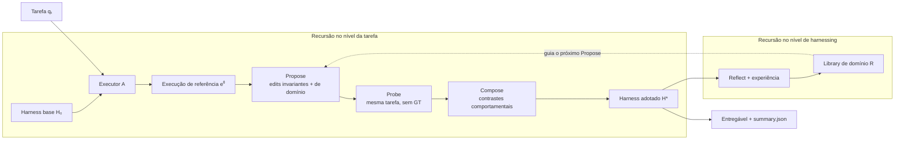
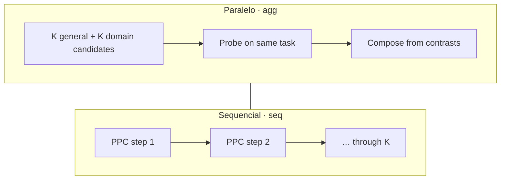
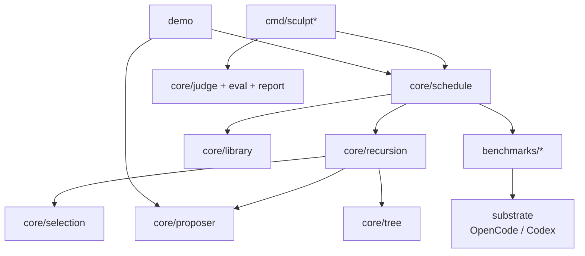

<p align="center">
  
</p>

<h1 align="center">Sculpt</h1>

<p align="center">
  <b>Esculpa o harness. Congele os pesos.</b><br/>
  Um framework Go de <i>harnessing recursivo de agentes</i> — refine o sistema ao redor do modelo e lembre o que funcionou.
</p>

<p align="center">
  <a href="README.md">English</a> ·
  <a href="README.zh-CN.md">简体中文</a> ·
  <a href="README.ja.md">日本語</a> ·
  <a href="README.ko.md">한국어</a> ·
  <a href="README.es.md">Español</a> ·
  <a href="README.fr.md">Français</a> ·
  <a href="README.de.md">Deutsch</a> ·
  <a href="README.pt-BR.md">Português</a> ·
  <a href="docs/i18n/README.md">More</a>
</p>

<p align="center">
  <a href="https://github.com/linuslin-cto/Sculpt/stargazers"></a>
  <a href="https://github.com/linuslin-cto/Sculpt/network/members"></a>
  &nbsp;
  <a href="LICENSE"></a>
  <a href="https://go.dev/"></a>
  <a href="https://arxiv.org/abs/2610.14224"></a>
  <a href="docs/EVAL.md"></a>
  <a href="#autoevolução"></a>
</p>

<p align="center">
  <code>go test ./demo -run TestSelfEvolution</code>
  &nbsp;·&nbsp;
  <code>go run ./cmd/sculpt-demo --k 2</code>
  &nbsp;·&nbsp;
  <b>o loop offline não precisa de API keys</b>
</p>

---

Um **harness** é tudo o que envolve um modelo para que ele atue como agente —
prompts, ferramentas, memória, skills, scripts, orquestração.

**Harnessing** é otimizar esse wrapper **sem tocar nos pesos do modelo**.

**Sculpt** é um framework Go de **harnessing recursivo de agentes** em mundo aberto:
agentes encontram tarefas nunca vistas no desenho do harness. Mantém pesos fixos
e melhora o harness com dois loops aninhados — o mesmo método de
[Harness²](https://github.com/google-research/harness2)
([paper](https://arxiv.org/abs/2610.14224)).

| | |
|---|---|
| **Nível de tarefa** | **Propose → Probe → Compose** contrastivo: edita, sonda na *mesma* tarefa, compõe a partir de contrastes comportamentais — **sem feedback de ground truth** no improver. |
| **Nível de harnessing** | Persiste o harness adotado + lições com evidência numa **library** por domínio que guia a próxima tarefa. |

> Contrato offline (verificado): **base 0% → refined 100% (+100 pt)** em 100/100 rodadas determinísticas.
> Smoke de reparo Live DeepSeek: **100/100** no mesmo contrato Δ.

### Resultados em destaque

| Sinal | Valor |
|-------|-------|
| Autoevolução offline (determinística) | **base 0% → refined 100% (+100 pt)** · 100/100 |
| Smoke Live DeepSeek | **100/100** no mesmo contrato Δ |
| Picos do paper (qualitativos) | WorkBuddy **+11.5** · JobBench **+4.5** · LAB partial **+11.8 pp** |

## Por que Sculpt

- **Pesos congelados** — todos os ganhos vêm do sistema ao redor do modelo.
- **O juiz não vaza para o improver** — a seleção é cega ao ground truth.
- **Nativo em Go** — seams tipados, testes rápidos, CLIs de um único binário.
- Recursão **paralela e sequencial** (`agg` / `seq`) com orçamentos `R=4k` / `P=3k`.
- **Autoevolução mensurável** — julga base vs refined e reporta Δ em pontos percentuais.
- **Adapters prontos** — JobBench, LAB, WorkBuddy-Bench (+ demo offline).

## Arquitetura

### Pipeline (tarefa → library)



### Paralelo explora · sequencial aprofunda



### Mapa de pacotes



### Oito componentes editáveis

Alinhados ao paper — a superfície que o Sculpt lê, escreve e valida:

| Contexto | Loop de ferramentas | Orquestração |
|----------|---------------------|--------------|
| system prompt · guardrails · memory · skills | tool guidance · scripts | subagents · plugins |

## Conteúdo

- [Por que Sculpt](#por-que-sculpt)
- [Arquitetura](#arquitetura)
- [Status](#status)
- [Instalação](#instalação)
- [Início rápido](#início-rápido)
- [Autoevolução](#autoevolução)
- [Benchmarks](#benchmarks)
- [Experimentos](#experimentos)
- [Layout](#layout)
- [Internacionalização](#internacionalização)
- [Citação](#citação)
- [Contribuir](#contribuir)
- [Licença](#licença)
- [Aviso](#aviso)

## Status

| Área | Estado |
|------|--------|
| Demo offline + Propose–Probe–Compose | ✅ Ready |
| Tree · ledger · recursion · selection · schedule · library · judge | ✅ Ready |
| Resume / selection failure / rejudge-merge | ✅ Tested |
| Eval de autoevolução (`TestSelfEvolution*`) | ✅ Offline **+100 pt** |
| Smoke Live DeepSeek | ✅ **100/100** |
| CLI: `sculpt` · `sculpt-demo` · `sculpt-judge` · `sculpt-report` · `sculpt-check` | ✅ Ready |
| Adapters JobBench / LAB / WorkBuddy | ✅ Wired |
| Live Execute via OpenCode / Codex | ⏳ Precisa de checkouts + credenciais |

## Instalação

```bash
git clone https://github.com/linuslin-cto/Sculpt.git
cd Sculpt
go test ./...
```

**Requisitos**

- Go **1.22+**
- Python **3.x** no `PATH` (o executor demo roda `scripts/summarize.py`)
- Caminho live opcional: OpenCode ou Codex, datasets, `SCULPT_*` / keys de provedor

Veja [docs/SETUP.md](docs/SETUP.md). Nunca faça commit de segredos — use um `.env` gitignored.

## Início rápido

```bash
# Propose–Probe–Compose determinístico (sem credenciais)
go run ./cmd/sculpt-demo --output runs/demo --k 2
go run ./cmd/sculpt-demo --output runs/demo-s7 --k 1 --seed 7

# Prévia do stream de tarefas
go run ./cmd/sculpt --bench demo --output runs/demo --k 1 --seed 7 --dry-run

# Pontuar autoevolução: refined + bases → Δ
go run ./cmd/sculpt-judge --bench demo --output runs/demo --k 1 --modes parallel
go run ./cmd/sculpt-judge --bench demo --output runs/demo --k 1 --bases
go run ./cmd/sculpt-report --bench demo --output runs/demo --k 1
```

Preflight:

```bash
go run ./cmd/sculpt-check --bench demo --output runs/check-demo
go run ./cmd/sculpt-check --bench jb --substrate oc --output runs/check-jb
```

## Autoevolução

Mesma forma de avaliação do demo / guia de experimentos da pesquisa:

1. **Base falha** — `scripts/summarize.py` só-positivo deixa créditos de fora.
2. **PPC no nível da tarefa** — propose · probe · compose sem ler `reference_answer.txt`.
3. **Nível de harnessing** — harness adotado + experiência caem em `library/` para a próxima tarefa.

```bash
go test ./demo -run TestSelfEvolution
```

| Etapa | Contrato offline |
|-------|------------------|
| Harness base | **0%** |
| Após um passo PPC | **100%** |
| Δ | **+100 pt** |

Picos do paper em benches live (alvos qualitativos, não gates de CI): WorkBuddy **+11.5**, JobBench **+4.5**, LAB partial **+11.8 pp** — veja [docs/EVAL.md](docs/EVAL.md).

## Benchmarks

| Benchmark | Alias | Foco |
|-----------|-------|------|
| Demo offline | `demo` | Ledger / PPC determinístico |
| JobBench | `jb` | Trabalho profissional |
| LAB | `lab` | Trabalho jurídico |
| WorkBuddy-Bench | `wb` | Office · web · code |

```bash
go run ./cmd/sculpt --bench demo --k 1 --seed 7 --dry-run
go run ./cmd/sculpt --bench jb --substrate oc --k 1 --modes parallel --dry-run
```

| Flag | Significado |
|------|-------------|
| `--k K` | Orçamento de recursão (`R=4k` rollouts, `P=3k` sessões improver) |
| `--modes parallel,sequential` | Namespaces `agg` / `seq` |
| `--substrate oc \| cx` | OpenCode ou Codex |
| `--only-domains …` | Restringir domínios |
| `--max-tasks N` | Teto por domínio |
| `--dry-run` | Só prévia do stream |

Judge e report devem reutilizar o mesmo bench, substrate, `--k`, modes e seed.

## Experimentos

| Opção | Comportamento |
|-------|---------------|
| `--k 1` | Um passo Propose–Probe–Compose |
| `--k K --modes parallel` | Explora pools mais largos, depois compõe |
| `--k K --modes sequential` | Refina mais fundo em `K` passos sucessivos |
| `--substrate cx` | Codex em vez de OpenCode |

| Env | Papel |
|-----|-------|
| `SCULPT_PHASE_WIDTH` | Concorrência Propose/rollout (padrão `2`) |
| `SCULPT_IMPROVER_MODEL` | Id do modelo improver (prefixo provider para OpenCode) |
| `SCULPT_SOLVER_MODEL` | Modelo solver para execute live |
| `SCULPT_RUNS_DIR` | Sobrescreve a raiz de runs |

Repita o mesmo comando para **retomar**. Use uma nova raiz de saída ao mudar modelos ou seleção de tarefas.

## Layout

| Caminho | Papel |
|---------|-------|
| `core/tree` | Superfície de harness c1..c8 |
| `core/spec` | BenchSpec + seam do adapter |
| `core/ledger` | Identidade `R=4k` / `P=3k` |
| `core/recursion` | PPC paralelo + sequencial |
| `core/selection` | Escolha cega + reflexão |
| `core/schedule` | Namespaces · streams · domínios |
| `core/library` | Store de experiência por domínio |
| `core/judge` · `eval` · `report` | Scores e Δ |
| `demo` | Adapter / proposer determinístico |
| `benchmarks/*` | jb · lab · wb · discovery |
| `substrate` | Superfícies OpenCode / Codex |
| `cmd/sculpt*` | CLIs |
| `docs/` | Setup · eval · i18n · notas do paper |

## Internacionalização

| Locale | Entrada |
|--------|---------|
| English | [README.md](README.md) |
| 简体中文 | [README.zh-CN.md](README.zh-CN.md) |
| 日本語 | [README.ja.md](README.ja.md) |
| 한국어 | [README.ko.md](README.ko.md) |
| Español | [README.es.md](README.es.md) |
| Français | [README.fr.md](README.fr.md) |
| Deutsch | [README.de.md](README.de.md) |
| Português (BR) | [README.pt-BR.md](README.pt-BR.md) |

Guia: [docs/i18n/README.md](docs/i18n/README.md).

**Regra:** não traduza comandos, caminhos, flags nem nomes `SCULPT_*`.

## Citação

Se você usa o método de harnessing recursivo, cite o trabalho original:

```bibtex
@article{xu2026harness2,
  title   = {Harness$^2$: Recursive Agent Harnessing for an Open World},
  author  = {Xu, Ruiyao and Chen, Yanfei and CuiZhu, Zhongying and Dalvi Mishra, Bhavana and Ming, Yifei and Yu, Han and Han, Rujun and Lee, Chen-Yu and Pfister, Tomas},
  journal = {arXiv preprint arXiv:2610.14224},
  year    = {2026},
  url     = {https://arxiv.org/abs/2610.14224}
}
```

## Contribuir

Veja [CONTRIBUTING.md](CONTRIBUTING.md). Traduções: [docs/i18n/README.md](docs/i18n/README.md).

## Licença

Apache **2.0** — veja [LICENSE](LICENSE).

Método upstream, benches e runners de terceiros mantêm as próprias licenças.
A árvore de pesquisa [harness2](https://github.com/google-research/harness2) **não** é redistribuída como superfície de produto do Sculpt.

## Aviso

Sculpt é um projeto open-source independente inspirado em pesquisa publicada.
**Não** é um produto oficial do Google e não é afiliado ao Google Research.
