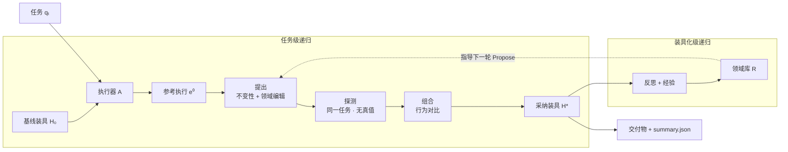
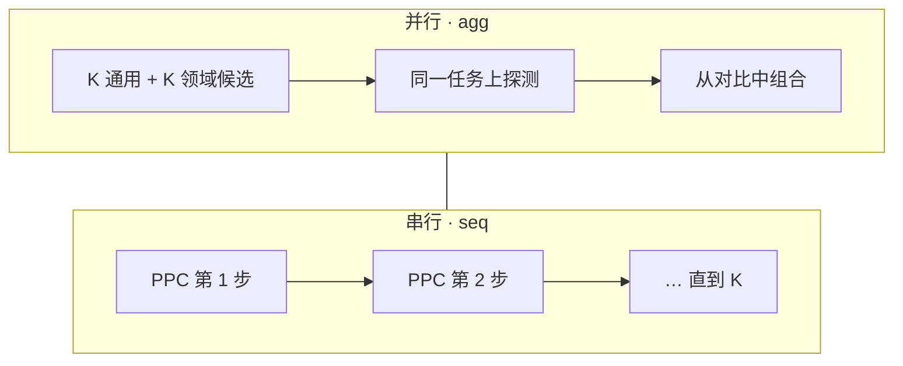
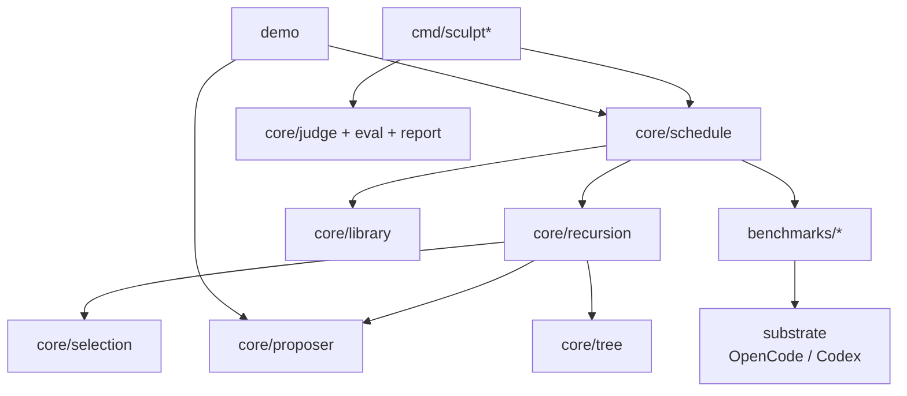

<p align="center">
  
</p>

<h1 align="center">Sculpt</h1>

<p align="center">
  <b>雕琢装具，冻结权重。</b><br/>
  Go 实现的<i>递归智能体装具化</i> —— 改进模型外围的系统，并记住什么真正有效。
</p>

<p align="center">
  <a href="README.md">English</a> ·
  <a href="README.zh-CN.md">简体中文</a> ·
  <a href="README.ja.md">日本語</a> ·
  <a href="README.ko.md">한국어</a> ·
  <a href="README.es.md">Español</a> ·
  <a href="README.fr.md">Français</a> ·
  <a href="README.de.md">Deutsch</a> ·
  <a href="README.pt-BR.md">Português</a> ·
  <a href="docs/i18n/README.md">更多</a>
</p>

<p align="center">
  <a href="https://github.com/linuslin-cto/Sculpt/stargazers"></a>
  <a href="https://github.com/linuslin-cto/Sculpt/network/members"></a>
  &nbsp;
  <a href="LICENSE"></a>
  <a href="https://go.dev/"></a>
  <a href="https://arxiv.org/abs/2610.14224"></a>
  <a href="#实证"></a>
</p>

<p align="center">
  <code>go test ./demo -run TestSelfEvolution</code>
  &nbsp;·&nbsp;
  <code>go run ./cmd/sculpt-demo --k 2</code>
  &nbsp;·&nbsp;
  <b>离线闭环 · 无需 API Key</b>
</p>

---

> **一句话：** 权重不动。每道任务用 **提出 → 探测 → 组合** 雕出更好装具，再把证据折进领域 **library**，指导下一次。

**装具（harness）** 是包在模型外面、让它能充当智能体的那一整套系统：
提示词、工具、记忆、技能、脚本、编排……

**装具化（harnessing）** 是在**不改模型权重**的前提下，优化这套外围系统。

**Sculpt** 把 [Harness²](https://github.com/google-research/harness2) 风格的
**递归智能体装具化**（[论文](https://arxiv.org/abs/2610.14224)）落到 Go：
类型化缝合面、快速测试、可续跑 CLI，以及可度量的基线 → 精炼 **Δ**。

| 层级 | 发生什么 |
|------|----------|
| **任务级** | 同一任务上对比式 **提出 → 探测 → 组合** —— 改进环路**不见真值** |
| **装具化级** | 将被采纳装具与有证据的经验写入按领域划分的 **library**，指导后续任务 |

### 头条结果

| 信号 | 数值 |
|------|------|
| 离线自进化（确定性） | **基线 0% → 精炼 100%（+100 pt）** · 100/100 |
| Live DeepSeek 修复冒烟 | 同 Δ 约定下 **100/100** |
| 方法论文峰值（定性） | WorkBuddy **+11.5** · JobBench **+4.5** · LAB Partial **+11.8 pp** |

## 为什么选 Sculpt

| | |
|---|---|
| **权重冻结** | 增益全部来自模型*外围*系统 |
| **盲选** | 改进器不见阅卷器 —— 无真值泄漏 |
| **Go 原生** | `BenchmarkAdapter` 缝合面、单二进制 CLI、秒级测试 |
| **双递归模式** | 并行（`agg`）更宽探索 · 串行（`seq`）更深精炼 |
| **显式预算** | `R=4k` rollout · `P=3k` 改进会话 |
| **基准就绪** | JobBench · LAB · WorkBuddy-Bench · 离线 demo |

## 架构

### 端到端流水线



### 并行更宽 · 串行更深



### 包结构



### 八个可编辑组件

Sculpt 读写并校验的装具表面（与方法论文对齐）：

| 上下文 | 工具环 | 编排 |
|--------|--------|------|
| system prompt · guardrails · memory · skills | tool guidance · scripts | subagents · plugins |

## 目录

- [为什么选 Sculpt](#为什么选-sculpt)
- [架构](#架构)
- [实证](#实证)
- [状态](#状态)
- [安装](#安装)
- [快速开始](#快速开始)
- [基准](#基准)
- [实验](#实验)
- [布局](#布局)
- [国际化](#国际化)
- [引用](#引用)
- [贡献](#贡献)
- [许可证](#许可证)
- [免责声明](#免责声明)

## 实证

评测形态对齐研究 demo：

1. **基线失败** —— 只加正数的 `scripts/summarize.py` 漏掉贷方。
2. **任务级 PPC** —— 提出 · 探测 · 组合，不读 `reference_answer.txt`。
3. **装具化级** —— 采纳装具与经验写入 `library/`，供后续任务使用。

```bash
go test ./demo -run TestSelfEvolution
```

| 阶段 | 离线约定 |
|------|----------|
| 基线装具 | **0%** |
| 一次 PPC 之后 | **100%** |
| Δ | **+100 pt** |

详见 [docs/EVAL.zh-CN.md](docs/EVAL.zh-CN.md)。

## 状态

| 能力 | 状态 |
|------|------|
| 离线 demo + Propose–Probe–Compose | ✅ 可用 |
| tree · ledger · recursion · selection · schedule · library · judge | ✅ 可用 |
| 断点续跑 / 选择失败 / rejudge-merge | ✅ 有测试 |
| 自进化评测（`TestSelfEvolution*`） | ✅ 离线 **+100 pt** |
| Live DeepSeek 修复冒烟 | ✅ **100/100** |
| CLI：`sculpt` · `sculpt-demo` · `sculpt-judge` · `sculpt-report` · `sculpt-check` | ✅ 可用 |
| JobBench / LAB / WorkBuddy 适配器 | ✅ 已接线 |
| OpenCode / Codex 在线 Execute | ⏳ 需 checkout + 凭证 |

## 安装

```bash
git clone https://github.com/linuslin-cto/Sculpt.git
cd Sculpt
go test ./...
```

**依赖：** Go **1.22+** · `PATH` 上的 Python **3.x**（demo 跑 `scripts/summarize.py`） · 可选在线路径：OpenCode / Codex + `SCULPT_*` / 供应商密钥。

详见 [docs/SETUP.zh-CN.md](docs/SETUP.zh-CN.md)。复制 [`.env.example`](.env.example) → `.env` —— 切勿提交密钥。

## 快速开始

```bash
# 确定性 Propose–Probe–Compose（无需凭证）
go run ./cmd/sculpt-demo --output runs/demo --k 2
go run ./cmd/sculpt-demo --output runs/demo-s7 --k 1 --seed 7

# 预览任务流
go run ./cmd/sculpt --bench demo --output runs/demo --k 1 --seed 7 --dry-run

# 自进化打分：精炼结果 + 基线 → Δ
go run ./cmd/sculpt-judge --bench demo --output runs/demo --k 1 --modes parallel
go run ./cmd/sculpt-judge --bench demo --output runs/demo --k 1 --bases
go run ./cmd/sculpt-report --bench demo --output runs/demo --k 1
```

就绪检查：

```bash
go run ./cmd/sculpt-check --bench demo --output runs/check-demo
go run ./cmd/sculpt-check --bench jb --substrate oc --output runs/check-jb
```

## 基准

| 基准 | 别名 | 侧重 |
|------|------|------|
| 离线 demo | `demo` | 确定性账本 / PPC |
| JobBench | `jb` | 专业工作 |
| LAB | `lab` | 法律工作 |
| WorkBuddy-Bench | `wb` | 办公 · Web · 代码 |

```bash
go run ./cmd/sculpt --bench demo --k 1 --seed 7 --dry-run
go run ./cmd/sculpt --bench jb --substrate oc --k 1 --modes parallel --dry-run
```

| 参数 | 含义 |
|------|------|
| `--k K` | 递归预算（`R=4k` 次 rollout，`P=3k` 次改进会话） |
| `--modes parallel,sequential` | `agg` / `seq` 命名空间 |
| `--substrate oc \| cx` | OpenCode 或 Codex |
| `--only-domains …` | 限制领域 |
| `--max-tasks N` | 每领域上限 |
| `--dry-run` | 仅预览任务流 |

评判与报告必须复用同一 bench、substrate、`--k`、modes 与 seed。

## 实验

| 选项 | 行为 |
|------|------|
| `--k 1` | 一次 Propose–Probe–Compose |
| `--k K --modes parallel` | 更宽的候选探测，再组合 |
| `--k K --modes sequential` | 连续 `K` 步更深精炼 |
| `--substrate cx` | 使用 Codex |

| 环境变量 | 作用 |
|----------|------|
| `SCULPT_PHASE_WIDTH` | 提出/rollout 并发（默认 `2`） |
| `SCULPT_IMPROVER_MODEL` | 改进器模型 id（OpenCode 需带 provider 前缀） |
| `SCULPT_SOLVER_MODEL` | 在线执行求解模型 |
| `SCULPT_RUNS_DIR` | 覆盖 runs 根目录 |

重复同一命令即可 **续跑**。更换模型或任务选择时请换新的输出目录。

## 布局

| 路径 | 职责 |
|------|------|
| `core/tree` | c1..c8 装具表面 |
| `core/spec` | BenchSpec + 适配器缝合面 |
| `core/ledger` | `R=4k` / `P=3k` 预算恒等式 |
| `core/recursion` | 并行 + 串行 PPC |
| `core/selection` | 盲选 + 反思 |
| `core/schedule` | 命名空间 · 任务流 · 领域 |
| `core/library` | 按领域的经验库 |
| `core/judge` · `eval` · `report` | 打分与 Δ |
| `demo` | 确定性适配器 / 提出器 |
| `benchmarks/*` | jb · lab · wb · 发现 |
| `substrate` | OpenCode / Codex 表面 |
| `cmd/sculpt*` | CLI |
| `docs/` | 安装 · 评测 · i18n · 论文笔记 |

## 国际化

| 语言 | 入口 |
|------|------|
| English | [README.md](README.md) |
| 简体中文 | [README.zh-CN.md](README.zh-CN.md) |
| 日本語 | [README.ja.md](README.ja.md) |
| 한국어 | [README.ko.md](README.ko.md) |
| Español | [README.es.md](README.es.md) |
| Français | [README.fr.md](README.fr.md) |
| Deutsch | [README.de.md](README.de.md) |
| Português (BR) | [README.pt-BR.md](README.pt-BR.md) |

贡献指南：[docs/i18n/README.md](docs/i18n/README.md)。

**约定：** 命令、路径、flags 与 `SCULPT_*` 名称保持英文，不要翻译。

## 引用

若使用递归装具化方法，请引用原作：

```bibtex
@article{xu2026harness2,
  title   = {Harness$^2$: Recursive Agent Harnessing for an Open World},
  author  = {Xu, Ruiyao and Chen, Yanfei and CuiZhu, Zhongying and Dalvi Mishra, Bhavana and Ming, Yifei and Yu, Han and Han, Rujun and Lee, Chen-Yu and Pfister, Tomas},
  journal = {arXiv preprint arXiv:2610.14224},
  year    = {2026},
  url     = {https://arxiv.org/abs/2610.14224}
}
```

## 贡献

见 [CONTRIBUTING.md](CONTRIBUTING.md)。文档翻译请遵循 [docs/i18n/README.md](docs/i18n/README.md)。

## 许可证

Apache **2.0** —— 见 [LICENSE](LICENSE)。

上游方法、基准与第三方 runner 保留各自许可证。
[harness2](https://github.com/google-research/harness2) 研究代码**不**作为 Sculpt 产品表面再分发。

## 免责声明

Sculpt 是受已发表研究启发的独立开源项目。
它**不是** Google 官方产品，亦与 Google Research 无隶属关系。
